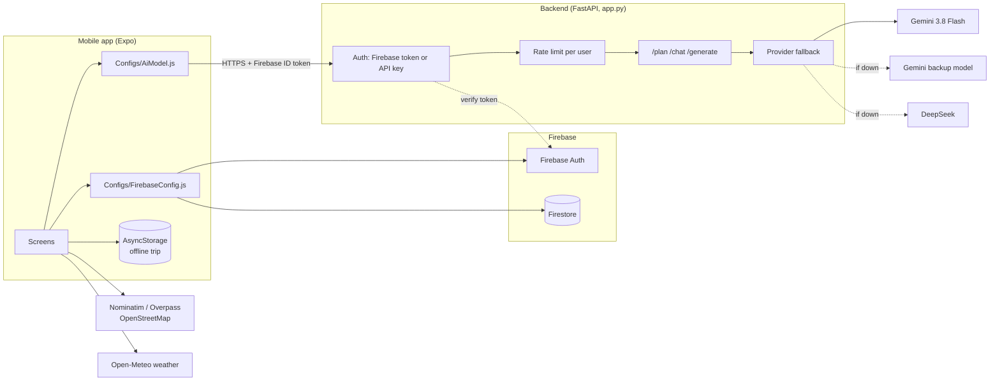
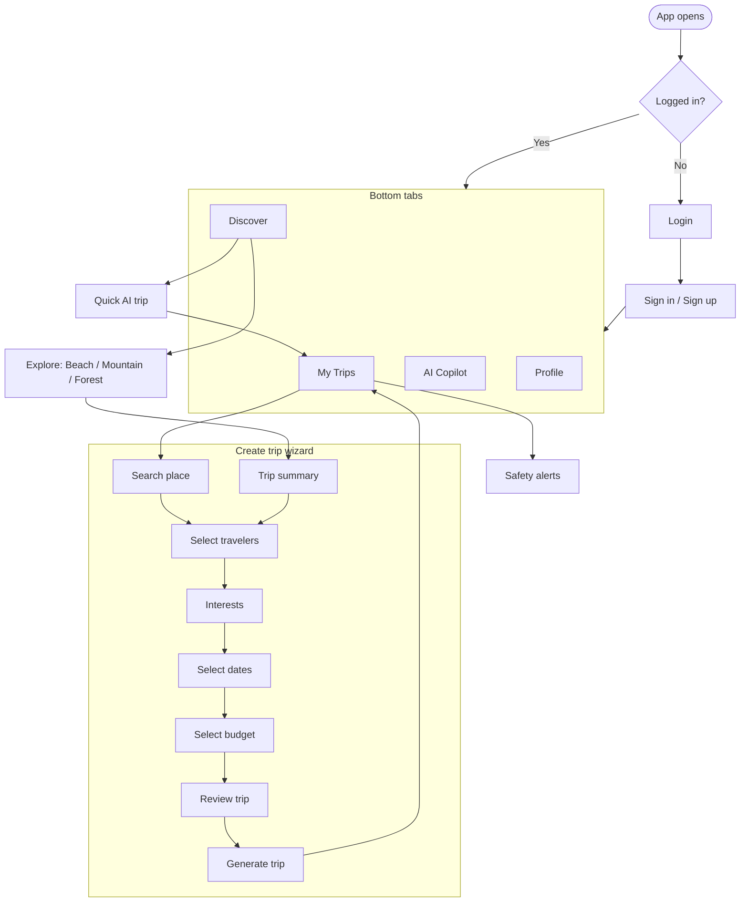
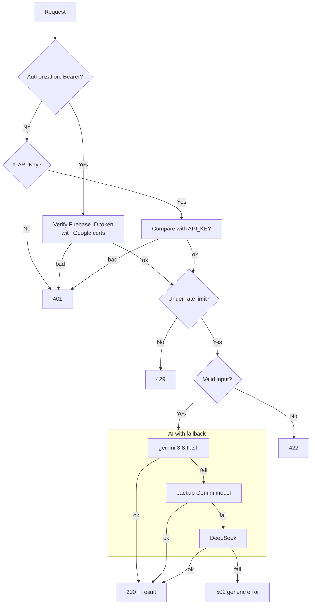
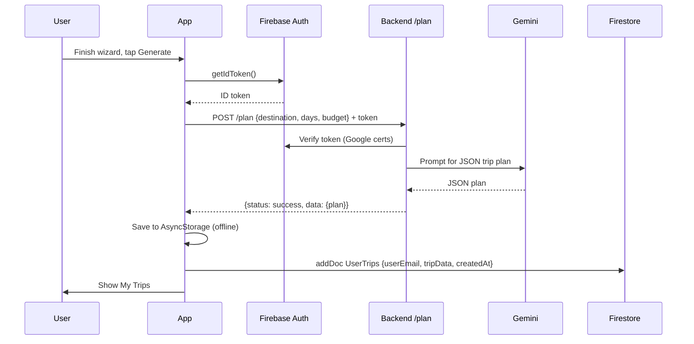

# GoGuide Architecture

How GoGuide is built and how a request flows through it.

---

## 1. Overview

GoGuide is an AI travel planner. It has three parts:

| Part | Tech | Folder |
|---|---|---|
| Mobile app | React Native, Expo, Expo Router | `app/Go Guide/` |
| Backend API | Python, FastAPI | `app.py` |
| Cloud services | Firebase Auth, Firestore, Gemini, DeepSeek, OpenStreetMap, Open-Meteo | external |

There is also an older Streamlit planner (`streamlit.py`) that runs 10 CrewAI agents. It is separate from the mobile app and the API.

---

## 2. System diagram



Key rule: the app holds **no AI keys**. Only the backend talks to Gemini and DeepSeek.

---

## 3. Mobile app

### 3.1 Folder layout

```
app/Go Guide/
├── app/                      Screens (Expo Router, file = route)
│   ├── index.jsx             Entry: logged in -> My Trips, else Login
│   ├── _layout.jsx           Root stack
│   ├── (tabs)/               Bottom tabs
│   │   ├── mytrip.jsx        Current trip, weather, packing list, offline mode
│   │   ├── discover.jsx      Search, categories, quick AI trips
│   │   ├── ai-assistant.jsx  AI Travel Copilot chat
│   │   └── profile.jsx       Profile and settings
│   ├── auth/                 Sign in, sign up
│   ├── create-trip/          Step by step trip wizard
│   ├── explore.jsx           Beach / Mountain / Forest list with filters
│   ├── beaches.jsx           Redirect to explore (category=beaches)
│   ├── mountains.jsx         Redirect to explore (category=mountains)
│   ├── forest.jsx            Redirect to explore (category=forest)
│   ├── safety-alerts.jsx     AI safety tips for the destination
│   ├── location.jsx          Save user location
│   ├── edit-profile.jsx, preferences.jsx, help-center.jsx
├── Components/               Reusable UI and constants
│   └── constants/Destinations.js   Data for the Explore screen
├── Configs/
│   ├── AiModel.js            All AI calls (goes to backend)
│   └── FirebaseConfig.js     Firebase app, auth, Firestore
├── context/CreateTripContext.js    Shared trip state and user profile
└── firestore.rules           Database security rules
```

### 3.2 Screens and navigation



### 3.3 State

| What | Where |
|---|---|
| Trip being created, user profile, preferences | `CreateTripContext` (React context) |
| Logged in user | Firebase Auth (`auth.currentUser`) |
| Last trip for offline use | AsyncStorage key `@goguide_cached_trip` |
| Saved trips | Firestore `UserTrips` |
| User profile | Firestore `users/{uid}` |

---

## 4. Backend API (`app.py`)

### 4.1 Endpoints

| Method | Path | Used by | What it does |
|---|---|---|---|
| GET | `/` | anyone | "API running" message |
| GET | `/health` | uptime checks | `{"status": "ok"}` |
| POST | `/plan` | Generate trip, Quick AI trip | Full trip plan as JSON (hotels, day by day itinerary) |
| POST | `/chat` | AI Copilot | Chat reply using the last 6 messages and the active trip |
| POST | `/generate` | Interests (no coordinates), Safety alerts | General prompt, JSON output |

### 4.2 Request pipeline



### 4.3 Security

| Protection | How |
|---|---|
| No keys in the app | App sends a Firebase ID token. Backend holds AI keys |
| Token check | Signature, audience and issuer checked against the Firebase project |
| Server key | `X-API-Key` compared in constant time. Server refuses all if `API_KEY` is not set |
| Rate limit | 30 requests per hour per user (in memory) |
| Input limits | `days` 1 to 30, text length caps, history max 20 |
| Error hiding | Users see "AI service error". Details only in server logs |
| Key not in URLs | Gemini key goes in the `x-goog-api-key` header |

### 4.4 Configuration

| Env var | Default | Purpose |
|---|---|---|
| `GEMINI_API_KEY` | none | Gemini access |
| `DEEPSEEK_API_KEY` | none | Fallback provider |
| `API_KEY` | none | Server to server key |
| `FIREBASE_PROJECT_ID` | `ai-travel-agent-e36a2` | Token audience |
| `GEMINI_MODELS` | `gemini-3.8-flash,gemini-3.5-flash` | Model order |
| `RATE_LIMIT_PER_HOUR` | `30` | Per user limit |
| `ALLOWED_ORIGINS` | `*` | CORS |

---

## 5. Data (Firestore)

| Collection | Doc id | Fields | Who can access |
|---|---|---|---|
| `users` | Firebase uid | `name`, `email`, `avatar`, `userLocation` | Only that user |
| `UserTrips` | auto id | `userEmail`, `tripData`, `createdAt` | Only the user whose email matches `userEmail` |

Everything else is denied. Rules live in `app/Go Guide/firestore.rules`.

---

## 6. Main workflows

### 6.1 Generate a trip



### 6.2 AI Copilot chat

1. User types a message in the Copilot tab.
2. `askTravelAssistant` sends the message, last 6 messages and the active trip to `POST /chat`.
3. Backend builds the "GoGuide AI Copilot" system prompt with the trip details.
4. Gemini replies. Backend returns `{reply}`.
5. If the backend fails, the app shows a friendly fallback tip.

### 6.3 Interests

1. If the place has coordinates, the app asks Overpass (OpenStreetMap) for real nearby places. No AI cost.
2. If not, it calls `POST /generate` with the interest prompt.

### 6.4 Safety alerts

1. Safety screen calls `fetchDestinationSafety(destination)`.
2. That calls `POST /generate` and expects a JSON list of 3 tips.
3. If it fails, the screen shows built in default tips.

### 6.5 Offline mode

1. After a trip is generated, it is saved in AsyncStorage.
2. My Trips reads Firestore when online and refreshes the cache.
3. With no internet, My Trips shows the cached trip.

---

## 7. External services

| Service | Used for | Called from |
|---|---|---|
| Firebase Auth | Sign in, ID tokens | App, backend (verify) |
| Firestore | Trips and profiles | App |
| Gemini API | Trip plans, chat, safety tips | Backend only |
| DeepSeek API | Fallback AI | Backend only |
| Nominatim (OpenStreetMap) | Place search | App |
| Overpass (OpenStreetMap) | Nearby interests | App |
| Open-Meteo | Weather | App |
| Unsplash | Images | App |

---

## 8. Running locally

Full steps for Linux and Windows, including firewall setup: see [LOCAL_SETUP.md](LOCAL_SETUP.md).

**Backend**

```bash
./venv/bin/uvicorn app:app --host 0.0.0.0 --port 8000      # Linux
.\venv\Scripts\uvicorn app:app --host 0.0.0.0 --port 8000  # Windows
```

**App** (phone and computer on the same WiFi)

```bash
cd "app/Go Guide"
npm start
```

In development the app finds the backend automatically: it takes the computer address Expo Go connected to and uses port 8000. `EXPO_PUBLIC_API_URL` is only needed for production or special cases.

**Tests**

```bash
./venv/bin/python -m pytest tests -v
```

---

## 9. Deployment

| Part | Where | Notes |
|---|---|---|
| Backend | Render (`render.yaml`) | `uvicorn app:app`, env vars in dashboard |
| App | Expo EAS Build (`eas.json`) | APK / AAB for Play Store |
| Firestore rules | Firebase CLI | `firebase deploy --only firestore:rules` |
| CI | GitHub Actions | `.github/workflows/backend-tests.yml` runs tests on backend changes |

---

## 10. Known limits

| Limit | Impact | Plan |
|---|---|---|
| Rate limit is in memory | Resets on restart, one server only | Move to Redis |
| Render free sleeps after 15 min | First request takes about 1 min | Uptime ping or paid plan |
| Trip ownership is by email | Changing auth email hides old trips | Add `userId` field later |
| Gemini free tier is small | `429` errors under load | Paid tier with spend cap, Redis cache |
| Nominatim fair use | Heavy search can get blocked | Debounce, own geocoder later |
