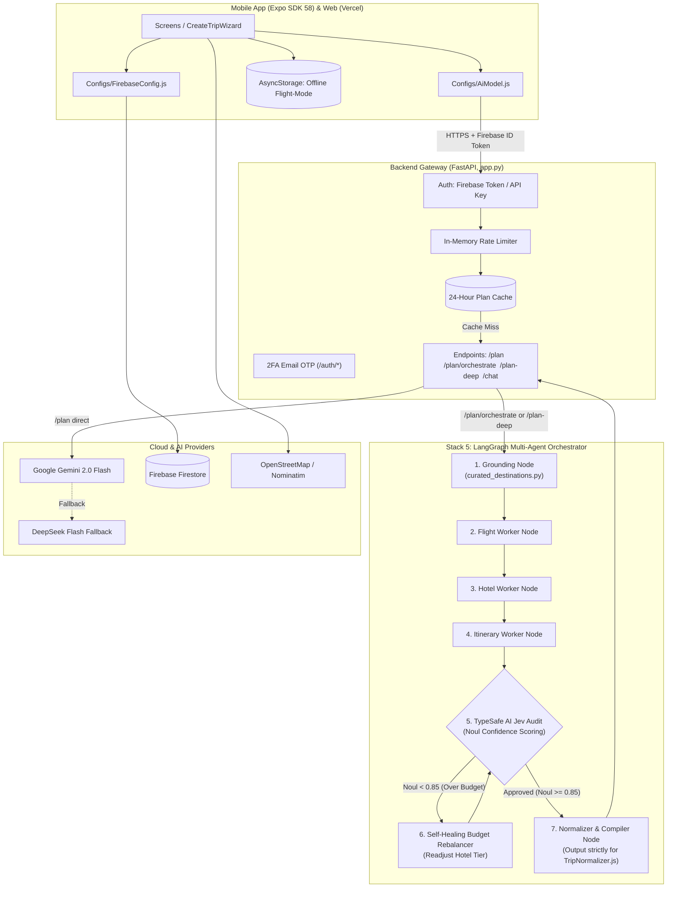
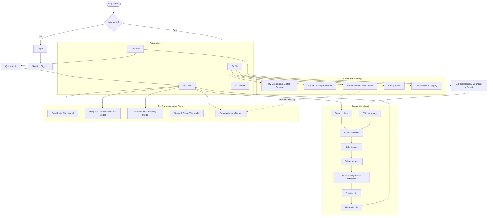
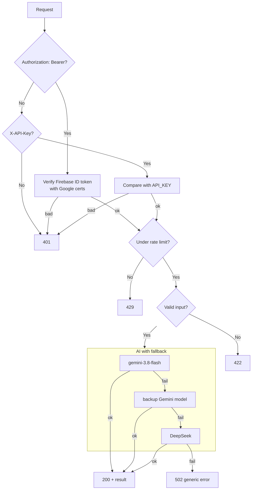
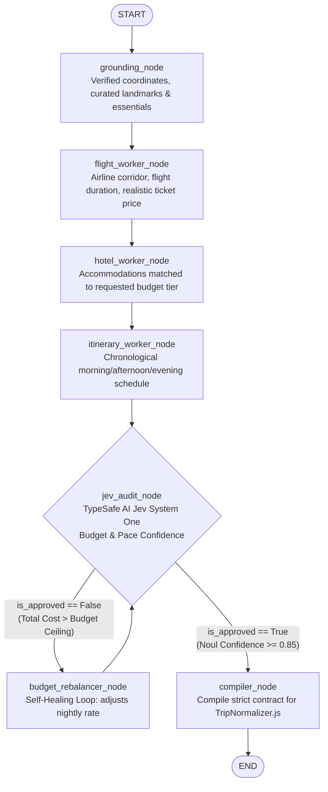
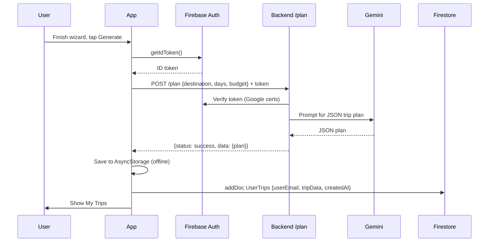

# GoGuide Architecture

How GoGuide is built and how a request flows through it.

---

## 1. Overview

GoGuide is an AI travel planner. It has four core pillars:

| Part | Tech | Folder / Module |
|---|---|---|
| Mobile app | React Native, Expo SDK 58, Expo Router, React 19 | `app/GoGuide/` |
| Backend API | Python 3.12, FastAPI, BackgroundTasks | `app.py` |
| AI Orchestration & Evaluation (Stack 5) | **LangGraph** (Stateful Multi-Agent Supervisor) + **TypeSafe AI Jev** (Sub-200ms Noul Confidence Decision Engine) | `orchestrator.py`, `jev_evaluator.py` |
| Cloud services | Firebase Auth, Firestore, Google Gemini 2.0 Flash / DeepSeek, OpenStreetMap, Open-Meteo | External |

In addition to direct LLM synthesis, GoGuide utilizes a **Stack 5 Master Multi-Agent Architecture**:
- **LangGraph Master Orchestrator (`orchestrator.py`)**: Stateful cyclical graph that coordinates factual grounding, flight corridors, hotel options, daily itinerary creation, and self-healing budget loops.
- **TypeSafe AI Jev System One Engine (`jev_evaluator.py`)**: Sub-200ms calibrated `Noul` confidence scoring that enforces strict budget limits without wasting secondary LLM tokens, with zero-downtime mathematical fallback.
- **Local Curated Grounding (`curated_destinations.py` & `travel_essentials.py`)**: Zero-token factual verification preventing hallucinated venues and coordinates.

---

## 2. System diagram



Key rule: the app holds **no AI keys**. Only the backend talks to Gemini and DeepSeek.

---

## 3. Mobile app

### 3.1 Folder layout

```
app/GoGuide/
├── app/                      Screens (Expo Router, file = route)
│   ├── index.jsx             Entry: logged in -> My Trips, else Login
│   ├── _layout.jsx           Root stack
│   ├── (tabs)/               Bottom tabs
│   │   ├── mytrip.jsx        Current trip, multi-trip carousel, route map, PDF, share, offline mode
│   │   ├── discover.jsx      Search, categories, AI Trip Generator (1-click itinerary planning)
│   │   ├── ai-assistant.jsx  AI Travel Copilot (24/7 live conversational chat assistant)
│   │   └── profile.jsx       Profile, explorer tiers, travel stats, and notification toggle
│   ├── trip/                 Universal web shareable dynamic itinerary viewer
│   ├── auth/                 Sign in, sign up
│   ├── create-trip/          Step by step trip wizard
│   │   ├── search-place.jsx  Origin (GPS / city) & Destination search
│   │   ├── select-traveler.jsx Companion selection
│   │   ├── select-dates.jsx  Dates and duration
│   │   ├── select-budget.jsx Dual-currency budget tiers (Destination + User Origin currency)
│   │   ├── interest-page.jsx Destination-smart category chips & interests
│   │   ├── review-trip.jsx   Pre-generation Boarding Pass with dual-currency estimator
│   │   └── generate-trip.jsx AI plan generator with radar animation
│   ├── my-bookings.jsx       Digital passes, vouchers, QR codes, status tabs
│   ├── packing-checklist.jsx Smart AI luggage & packing checklist with category filters
│   ├── explore.jsx           Beach / Mountain / Forest / Cities list with filters
│   ├── cities.jsx            Redirect to explore (category=cities)
│   ├── beaches.jsx           Redirect to explore (category=beaches)
│   ├── mountains.jsx         Redirect to explore (category=mountains)
│   ├── forest.jsx            Redirect to explore (category=forest)
│   ├── safety-alerts.jsx     AI safety tips for the destination
│   ├── location.jsx          Save user location
│   ├── edit-profile.jsx, preferences.jsx, help-center.jsx
├── components/               Reusable UI, constants & modals
│   ├── MyTrips/              Trip tools and interactive modals
│   │   ├── DayRouteModal.jsx            Multi-stop route map & distance calculator
│   │   ├── ExpenseTrackerModal.jsx      Budget cap gauge, expense logger with in-place edit & 1-tap quick renew
│   │   ├── HotelCardItem.jsx            Hotel card with dynamic Booking.com deep search links
│   │   ├── PrintableItineraryModal.jsx  Magazine-style printable PDF export
│   │   ├── ShareTripModal.jsx           Web link, social share & trip cloning
│   │   ├── WeatherCard.jsx, PackingList.jsx, StartNewTripCard.jsx
│   ├── utils/                Core utility & normalization helpers
│   │   ├── TripNormalizer.js     Universal schema unwrapper & array safety guard
│   │   └── PdfDownloadService.js Native jspdf vector PDF & HTML print fallback
│   └── constants/Destinations.js, Option.js, theme.js
├── Configs/
│   ├── AiModel.js            All AI calls (goes to backend)
│   └── FirebaseConfig.js     Firebase app, auth, Firestore
├── context/CreateTripContext.js    Shared trip state, preferences & user profile
└── firestore.rules           Database security rules
```

### 3.2 Screens and navigation



### 3.3 State

| What | Where |
|---|---|
| Trip being created, user profile, preferences | `CreateTripContext` (React context) |
| Logged in user | Firebase Auth (`auth.currentUser`) |
| Last trip for offline use | AsyncStorage key `@goguide_cached_trip` |
| User display & notification preferences | AsyncStorage key `@goguide_preferences` |
| In-progress trip draft | AsyncStorage key `tripData:{uid}` |
| Saved trips | Firestore `UserTrips` |
| Travel bookings & passes | Firestore `Bookings` |
| User profile | Firestore `users/{uid}` |

---

### 3.4 Data Normalization Layer (`TripNormalizer.js`)
All incoming and cached trip plans pass through `normalizeTrip(raw)`:
- Recursively decodes JSON strings and extracts payloads from `aiTripPlan`, `tripData`, `travelPlan`, or `trip` root keys.
- Converts dictionary-based itineraries (`{"day1": ...}`) to chronological array structures.
- Enforces array invariants for `itinerary`, `hotels`, and each day's `activities` to ensure `.filter()`, `.map()`, and `.length` calls never throw runtime errors.

---

## 4. Backend API (`app.py`)

### 4.1 Endpoints

| Method | Path | Used by | What it does |
|---|---|---|---|
| GET | `/` | anyone | "API running" message |
| GET | `/health` | uptime checks | `{"status": "ok"}` |
| POST | `/plan` | Generate trip, Quick AI trip | Full trip plan as JSON with customized `interests` & `categories` (hotels, day by day itinerary) |
| POST | `/plan/orchestrate` | Stack 5 Multi-Agent Client | **LangGraph Master Orchestration** with TypeSafe AI Jev confidence gating and self-healing budget loops |
| POST | `/plan-deep` | Async deep planning | Asynchronous background synthesis running LangGraph Orchestrator or Deep Plan engine |
| GET | `/plan-deep/{job_id}` | Async pollers | Polls background job status until `ready` |
| POST | `/chat` | AI Copilot | Chat reply using the last 6 messages and the active trip |
| POST | `/generate` | Interests (no coordinates), Safety alerts | General prompt, JSON output |
| GET | `/tools/destination-info` | Trip essentials | Zero-token travel essentials (visas, events, safety hotlines, currency) |

### 4.2 Request pipeline



### 4.3 Security

| Protection | How |
|---|---|
| No keys in the app | App sends a Firebase ID token. Backend holds AI keys |
| Token check | Signature, audience and issuer checked against the Firebase project |
| Server key | `X-API-Key` compared in constant time. Server refuses all if `API_KEY` is not set |
| Rate limit | 30 requests per hour per user (in memory) |
| Input limits | `days` 1 to 30, text length caps, history max 20 |
| Error hiding | Users see "AI service error". Details only in server logs |
| Key not in URLs | Gemini key goes in the `x-goog-api-key` header |

### 4.4 Configuration

| Env var | Default | Purpose |
|---|---|---|
| `GEMINI_API_KEY` | none | Gemini access |
| `DEEPSEEK_API_KEY` | none | Fallback provider |
| `JEV_API_KEY` | none | Optional TypeSafe AI Jev decision API key (automatic zero-downtime mathematical fallback active when omitted) |
| `API_KEY` | none | Server to server key |
| `FIREBASE_PROJECT_ID` | `goguideai` | Token audience |
| `GEMINI_MODELS` | `gemini-2.0-flash,gemini-1.5-flash` | Model order |
| `RATE_LIMIT_PER_HOUR` | `30` | Per user limit |
| `ALLOWED_ORIGINS` | `*` | CORS |

---

### 4.5 Stack 5 Multi-Agent Orchestration (`orchestrator.py` & `jev_evaluator.py`)

GoGuide uses **Stack 5** for stateful, validated multi-agent travel planning:

#### 1. Architecture Components
- **Orchestration Layer (`langgraph>=0.2.0`)**: Replaces brittle linear agent pipelines with a deterministic state graph (`StateGraph(TripState)`) featuring cyclical feedback and conditional branching.
- **Decision Engine (`TypeSafe AI Jev`)**: A sub-200ms non-autoregressive decision model returning calibrated **Noul confidence** ($[0.0, 1.0]$) and typed criteria verdicts. When `JEV_API_KEY` is not present, the engine automatically falls back to an exact mathematical budget/pace evaluation without breaking the pipeline.
- **Knowledge Grounding Layer**: Uses `curated_destinations.py` (34KB verified landmarks, hotel tiers, and coordinates) and `travel_essentials.py` to ground the LLM prior to generation, eliminating fabricated places.
- **Generative Synthesis**: Google Gemini 2.0 Flash with DeepSeek fallback for conversational nuance.

#### 2. Graph Workflow & Node Sequence


#### 3. TripState Schema
```python
class TripState(TypedDict, total=False):
    origin: str
    destination: str
    days: int
    budget_tier: str
    traveler_type: str
    interests: List[str]
    user_email: Optional[str]
    grounded_destination: Optional[Dict[str, Any]]
    essentials: Optional[Dict[str, Any]]
    flights: Optional[Dict[str, Any]]
    hotels: Optional[List[Dict[str, Any]]]
    itinerary: Optional[List[Dict[str, Any]]]
    total_cost: float
    jev_audit: Optional[Dict[str, Any]]
    iterations: int
    is_approved: bool
    final_plan: Optional[Dict[str, Any]]
```

#### 4. Quality Audit Response Contract
Every orchestrated plan delivers a transparent `qualityAudit` object alongside the travel schedule:
```json
"qualityAudit": {
  "orchestrator": "LangGraph Stateful Supervisor v5",
  "decisionEngine": "TypeSafe AI Jev (System One)",
  "noulConfidence": 0.894,
  "reasoning": "Optimal budget alignment and daily pacing.",
  "selfHealedLoops": 2
}
```

---

## 5. Data (Firestore)

| Collection | Doc id | Fields | Who can access |
|---|---|---|---|
| `users` | Firebase uid | `name`, `email`, `avatar`, `userLocation` | Only that user |
| `UserTrips` | auto id | `userEmail`, `tripData`, `createdAt` | Only the user whose email matches `userEmail` |
| `Bookings` | auto id | `userEmail`, `title`, `type`, `date`, `status`, `qrCode` | Only that user |

Everything else is denied. Rules live in `app/GoGuide/firestore.rules`.

---

## 6. Main workflows

### 6.1 Generate a trip



### 6.2 AI Copilot chat

1. User types a message in the Copilot tab.
2. `askTravelAssistant` sends the message, last 6 messages and the active trip to `POST /chat`.
3. Backend builds the "GoGuide AI Copilot" system prompt with the trip details.
4. Gemini replies. Backend returns `{reply}`.
5. If the backend fails, the app shows a friendly fallback tip.

### 6.3 Interests

1. If the place has coordinates, the app asks Overpass (OpenStreetMap) for real nearby places. No AI cost.
2. If not, it calls `POST /generate` with the interest prompt.

### 6.4 Safety alerts

1. Safety screen calls `fetchDestinationSafety(destination)`.
2. That calls `POST /generate` and expects a JSON list of 3 tips.
3. If it fails, the screen shows built in default tips.

### 6.5 Offline mode

1. After a trip is generated, it is saved in AsyncStorage.
2. My Trips reads Firestore when online and refreshes the cache.
3. With no internet, My Trips shows the cached trip.

---

## 7. External services

| Service | Used for | Called from |
|---|---|---|
| Firebase Auth | Sign in, ID tokens | App, backend (verify) |
| Firestore | Trips and profiles | App |
| Gemini API | Trip plans, chat, safety tips | Backend only |
| DeepSeek API | Fallback AI | Backend only |
| Nominatim (OpenStreetMap) | Place search | App |
| Overpass (OpenStreetMap) | Nearby interests | App |
| Open-Meteo | Weather | App |
| Unsplash | Images | App |

---

## 8. Running locally

Full steps for Linux and Windows, including firewall setup: see [LOCAL_SETUP.md](LOCAL_SETUP.md).

**Backend**

```bash
./venv/bin/uvicorn app:app --host 0.0.0.0 --port 8000      # Linux
.\venv\Scripts\uvicorn app:app --host 0.0.0.0 --port 8000  # Windows
```

**App** (phone and computer on the same WiFi)

```bash
cd "app/GoGuide"
npm start
```

In development the app finds the backend automatically: it takes the computer address Expo Go connected to and uses port 8000. `EXPO_PUBLIC_API_URL` is only needed for production or special cases.

**Tests**

```bash
./venv/bin/python -m pytest tests -v
```

---

## 9. Deployment

| Part | Where | Notes |
|---|---|---|
| Backend | Render (`render.yaml`) | `uvicorn app:app`, env vars in dashboard |
| Web Production | Vercel | Live at `https://dist-seven-tau-79.vercel.app` (35 routes) |
| App Mobile | Expo EAS Build (`eas.json`) | APK (`preview`) / AAB (`production`) for Play Store |
| Firestore rules | Firebase CLI | `firebase deploy --only firestore:rules` |
| CI / Tests | GitHub Actions | `.github/workflows/backend-tests.yml` runs tests on backend changes |
| 24/7 Keep-Alive | GitHub Actions | `.github/workflows/keep-alive.yml` pings `/health` every 14 mins |
| Compliance | In-App & Web | Terms (`/terms`), Privacy (`/privacy`), GDPR Account Deletion |

---

## 10. Known limits & Status

| Limit | Impact | Plan & Current Status |
|---|---|---|
| Rate limit is in memory | Resets on restart, one server only | Move to Redis |
| Render free sleeps after 15 min | First request takes about 1 min | **Resolved**: Automated GitHub Actions Keep-Alive workflow pings `/health` every 14 min |
| Trip ownership is by email | Changing auth email hides old trips | Add `userId` field later |
| Gemini free tier is small | `429` errors under load | Paid tier with spend cap; 24h plan cache in `app.py` serves repeat queries in 200ms |
| Nominatim fair use | Heavy search can get blocked | **Resolved**: 450ms debounce and custom User-Agent in place |
