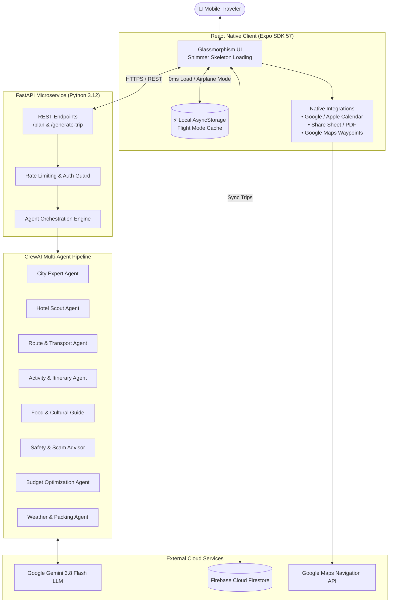

# 🌍 GoGuide AI — Autonomous Multi-Agent Travel Orchestration & Mobile Companion

[](https://expo.dev/)
[](https://reactnative.dev/)
[](https://fastapi.tiangolo.com/)
[](https://crewai.com)
[](https://ai.google.dev/)
[](https://firebase.google.com/)
[](https://opensource.org/licenses/MIT)

> **GoGuide AI** is an enterprise-grade, offline-first mobile travel companion powered by an autonomous **10-Agent CrewAI** pipeline and **Google Gemini 3.8 Flash**. It generates personalized day-by-day travel itineraries, flight and hotel recommendations, live destination safety alerts, multi-stop Google Maps routes, and 1-click calendar sync.

---

## 🏛️ System Architecture



---

## ✨ Key Production Features

### ⚡ 1. Offline-First Architecture (Flight Mode)
- **Zero-Latency Retrieval**: All generated trip data is automatically persisted to device storage via `@react-native-async-storage/async-storage`.
- **Airplane Mode Ready**: Full access to daily timelines, flight tickets, hotel contact numbers, and packing checklists without active Wi-Fi or cellular connections.
- **Visual Status Badging**: Live `⚡ Offline Ready` translucent badge and top-header sync pill.

### 🤖 2. 10-Agent Autonomous CrewAI Pipeline
- Rather than a generic single-prompt LLM, GoGuide orchestrates a specialized **10-agent team** using **CrewAI** and **Gemini 3.8 Flash**:
  1. **City Selection Specialist**: Analyzes season, traveler style, and budget.
  2. **Hotel & Accommodations Scout**: Curates verified stays with ratings, pricing, and amenities.
  3. **Flight & Transport Logistics**: Identifies optimal routes, layovers, and pricing estimates.
  4. **Activity & Attraction Curator**: Sequences daily attractions to minimize transit time.
  5. **Cultural & Culinary Guide**: Suggests authentic local dining, cultural customs, and etiquette.
  6. **Safety & Scam Intelligence**: Pinpoints tourist scam hotspots and emergency contacts.
  7. **Budget Optimization Agent**: Allocates expenditure across stays, transit, and activities.
  8. **Weather & Dynamic Packing Agent**: Matches 7-day weather patterns with tailored gear checklists.
  9. **Interactive Copilot Agent**: Real-time travel chat assistant with quick suggestion chips.
  10. **Quality Assurance Agent**: Validates JSON schema integrity and logical coherence.

### 📅 3. 1-Click Calendar Synchronization
- Directly integrates with **Google Calendar** and **Apple Calendar** using deep-link URLs.
- Automatically structures event titles, destination geo-locations, start and end dates (`YYYYMMDDTHHmmssZ`), and full daily breakdowns into the calendar event description.

### 📥 4. Printable Travel Document & Native Sharing
- Formats structured, printer-ready travel itineraries right inside an in-app **Document Viewer Modal**.
- Seamless integration with native **Share Sheet** (`Share.share`), enabling travelers to **Print (AirPrint / Android Print)**, **Save to Files as PDF**, **AirDrop**, or export directly to **WhatsApp** and **Email**.

### 🗺️ 5. Multi-Stop Route Navigation in Google Maps
- **Full Day Route**: Generates multi-waypoint driving and walking directions connecting each day's activities chronologically in Google Maps.
- **Turn-by-Turn GPS**: 1-tap "Directions" button on all hotel cards and attraction stops initiating GPS navigation from the traveler's live coordinates.

### 🛡️ 6. Live AI Destination Safety Scanner
- Real-time Gemini 3.8 Flash query tailored to the traveler's specific destination city.
- Live advisories on neighborhood safety, verified taxi practices, common street scams, emergency hotlines, and health guidelines.

### 🎨 7. Modern Glassmorphism UI & Shimmer Skeleton Loading
- **60fps Native Shimmer**: Replaced generic loading spinners with animated placeholder skeleton cards mirroring real layouts.
- **Time-Coded Schedule Nodes**: Visual timeline with color-coded nodes (Amber Sunny for Morning, Sky Blue for Afternoon, Deep Purple Moon for Evening).
- **Interactive Day Filter Pills**: Instant day selection with native haptic feedback.

---

## 🛠️ Technology Stack

| Layer | Technology | Purpose |
| :--- | :--- | :--- |
| **Mobile App** | React Native (Expo SDK 57) | Cross-platform iOS & Android client |
| **Routing** | Expo Router (`file-based`) | Deep-linking and declarative tab navigation |
| **Local Storage** | AsyncStorage | Offline-first flight mode trip caching |
| **Backend API** | FastAPI (Python 3.12) | High-performance asynchronous microservice |
| **Multi-Agent System** | CrewAI | Autonomous multi-agent coordination and task delegation |
| **Primary LLM** | Google Gemini 3.8 Flash | Ultra-low latency, multimodal reasoning |
| **Cloud Database** | Firebase Firestore | Cloud sync, authentication, and user trips storage |
| **Maps & Geospatial** | Google Maps Universal URLs | Multi-waypoint navigation and directions |
| **Styling & Animation**| React Native Animated & Theme Provider | 60fps shimmer skeleton and dark/light palettes |

---

## 🚀 Quick Start Guide

### Prerequisites
- Node.js (v18+)
- Python (v3.10 - v3.12)
- Expo Go app on your physical iOS/Android device

### 1. Backend Setup (FastAPI & CrewAI)
```bash
# Clone the repository
git clone https://github.com/AliHassan-7869/GoGuide-AI-Agent.git
cd GoGuide-AI-Agent

# Set up virtual environment
python3 -m venv venv
source venv/bin/activate  # On Windows: venv\Scripts\activate

# Install dependencies
pip install -r requirements.txt

# Configure Environment Variables
cp .env.example .env
# Add your GEMINI_API_KEY in .env

# Start FastAPI Server
python app.py
# Server runs at http://localhost:5000
```

### 2. Mobile Frontend Setup (React Native / Expo)
```bash
# From repository root
npm install

# Start the Metro bundler
npm start
```
- Open **Expo Go** on your phone and scan the QR code displayed in the terminal.
- Press `w` to run in the web browser.

---

## 💼 Resume & ATS-Ready Project Bullets

Looking to showcase this project on your resume or portfolio? Use these pre-formatted, high-impact bullet points:

- **Full-Stack AI Travel Companion**: *Architected and deployed an offline-first mobile travel app with **React Native (Expo SDK 57)** and **FastAPI**, serving automated itineraries with sub-second perceived load times via native shimmer skeleton layouts and **AsyncStorage** caching.*
- **Autonomous Multi-Agent Orchestration**: *Engineered a 10-agent autonomous pipeline with **CrewAI** and **Google Gemini 3.8 Flash**, delegating discrete tasks across city curation, logistics, hotel scouting, route sequencing, and live scam/safety intelligence.*
- **System Integrations & Native APIs**: *Implemented 1-click **Google/Apple Calendar** synchronization, multi-waypoint **Google Maps** route navigation, and native document export (PDF/AirPrint/Share Sheet) handling end-to-end travel lifecycle management.*

---

## 📄 License
This project is licensed under the MIT License - see the [LICENSE](LICENSE) file for details.
