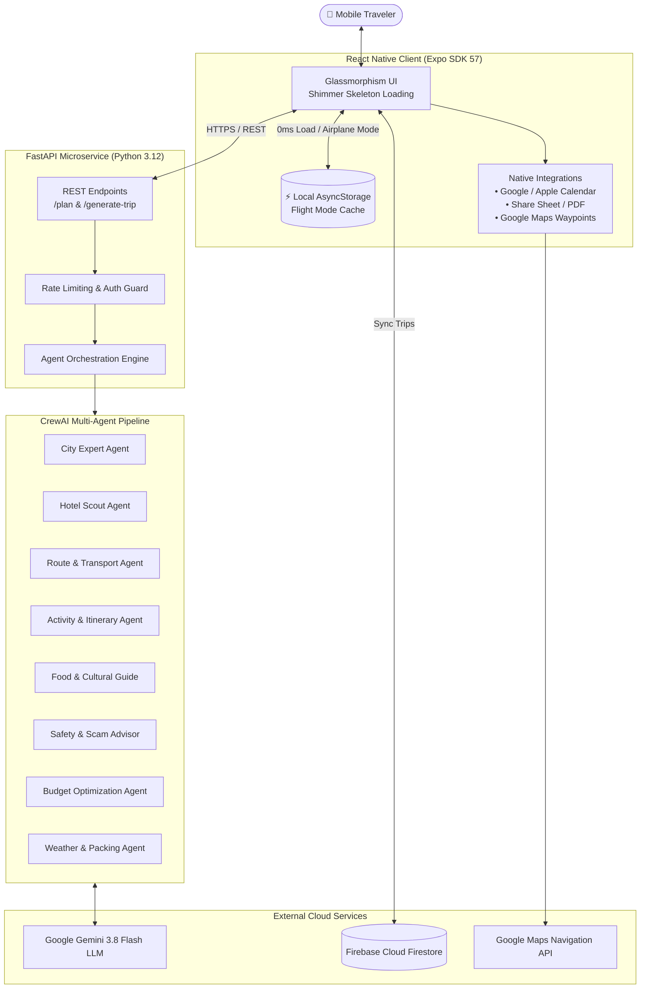

# 🌍 GoGuide AI — Autonomous Multi-Agent Travel Orchestration & Mobile Companion

[](https://expo.dev/)
[](https://reactnative.dev/)
[](https://fastapi.tiangolo.com/)
[](https://crewai.com)
[](https://ai.google.dev/)
[](https://firebase.google.com/)
[](https://opensource.org/licenses/MIT)

> **GoGuide AI** is an enterprise-grade, offline-first mobile & web travel companion powered by a consolidated **4-Agent CrewAI** pipeline, **Google Gemini 2.5 Flash & Groq Llama 3.3**, 100% Free-Tier optimizations, Origin-to-Destination Dual Currency conversion, and full account security (Email 2FA). It generates personalized day-by-day travel itineraries, flight and hotel recommendations, live destination safety alerts, multi-stop Google Maps routes, and 1-click calendar sync.

---

## 🏛️ System Architecture



---

## ✨ Key Production Features

### ⚡ 1. Offline-First Architecture (Flight Mode)
- **Zero-Latency Retrieval**: All generated trip data is automatically persisted to device storage via `@react-native-async-storage/async-storage`.
- **Airplane Mode Ready**: Full access to daily timelines, flight tickets, hotel contact numbers, and packing checklists without active Wi-Fi or cellular connections.
- **Visual Status Badging**: Live `⚡ Offline Ready` translucent badge and top-header sync pill.

### 🤖 2. Consolidated 4-Agent Autonomous Pipeline (60-70% Token Reduction)
- Rather than running 10 separate chat contexts that multiply LLM tokens, GoGuide consolidates the workflow into **4 expert agents** with specialized dynamic tools:
  1. **Destination & Culture Specialist (`destination_agent`)**: Analyzes seasonal events, cultural customs, culinary traditions, and attraction gems.
  2. **Budget & Logistics Scout (`budget_transport_agent`)**: Structures accommodation options, flight corridors, airport transit, and dynamic tier pricing.
  3. **Safety & Preparation Advisor (`safety_prep_agent`)**: Advises on neighborhood safety, common tourist scams, weather trends, packing essentials, and emergency hotlines.
  4. **Master Itinerary Architect (`planner_expert`)**: Synthesizes all inputs into an optimized, chronological day-by-day itinerary with exact timings and geolocation waypoints.

### 📅 3. 1-Click Calendar Synchronization
- Directly integrates with **Google Calendar** and **Apple Calendar** using deep-link URLs.
- Automatically structures event titles, destination geo-locations, start and end dates (`YYYYMMDDTHHmmssZ`), and full daily breakdowns into the calendar event description.

### 📥 4. Printable Travel Document & Native Sharing
- Formats structured, printer-ready travel itineraries right inside an in-app **Document Viewer Modal**.
- Seamless integration with native **Share Sheet** (`Share.share`), enabling travelers to **Print (AirPrint / Android Print)**, **Save to Files as PDF**, **AirDrop**, or export directly to **WhatsApp** and **Email**.

### 🗺️ 5. Multi-Stop Route Navigation in Google Maps
- **Full Day Route**: Generates multi-waypoint driving and walking directions connecting each day's activities chronologically in Google Maps.
- **Turn-by-Turn GPS**: 1-tap "Directions" button on all hotel cards and attraction stops initiating GPS navigation from the traveler's live coordinates.

### 🛡️ 6. Live AI Destination Safety Scanner
- Real-time Gemini 3.8 Flash query tailored to the traveler's specific destination city.
- Live advisories on neighborhood safety, verified taxi practices, common street scams, emergency hotlines, and health guidelines.

### 🎨 7. Modern Glassmorphism UI & Shimmer Skeleton Loading
- **60fps Native Shimmer**: Replaced generic loading spinners with animated placeholder skeleton cards mirroring real layouts.
- **Time-Coded Schedule Nodes**: Visual timeline with color-coded nodes (Amber Sunny for Morning, Sky Blue for Afternoon, Deep Purple Moon for Evening).
- **Interactive Day Filter Pills**: Instant day selection with native haptic feedback.

### 💰 8. In-Trip Expense Tracker & 1-Tap Quick Renew
- **Live Budget Consumption Gauge**: Visual progress bar tracking spending across *Food*, *Transport*, *Stay*, and *Activities*.
- **✏️ In-Place Edit**: 1-tap pencil icon to adjust title, amount, or category directly.
- **⚡ 1-Tap Quick Renew**: Direct repeat icon (`repeat-outline`) to duplicate frequent daily travel expenses (e.g. daily coffee, transit fares) with current timestamp.
- **🔁 Form Re-Add**: Option to renew logged expenses without tedious re-typing.

### 🏨 9. Dynamic Booking.com Hotel Links (Direct Reservations)
- Every hotel recommendation card dynamically links directly to **Booking.com** search results pre-filled with the exact hotel name, destination city, and dates.
- Seamless booking pipeline turning itineraries into actionable reservations in seconds.

### 🌐 10. Viral Web Itinerary Viewer & Rich Social Open Graph Previews
- **Universal Web Link**: Deployed at `https://dist-seven-tau-79.vercel.app/trip`, allowing travelers to share their trip with co-travelers who can view the complete itinerary in any mobile or desktop browser without installing the app.
- **Rich Social Previews**: Embedded Open Graph and Twitter Card tags ensure WhatsApp, iMessage, and Twitter shares render enticing preview cards with images and trip summaries.

### 🤖 11. Dual AI Engine Architecture (Generator vs. Conversational Copilot)
- **AI Trip Generator (Discover)**: 1-click comprehensive multi-day itinerary generation engine powered by `/plan` with 24-hour TTL caching for 200ms instantaneous repeat queries.
- **AI Copilot (Tab 3)**: 24/7 conversational travel concierge powered by `/chat` for live travel inquiries, cultural etiquette, packing questions, and neighborhood advice.

### 💱 12. Origin-to-Destination Dual Currency Engine
- **Smart Origin & Destination Detection**: Automatically detects the traveler's home currency from their departure city or device timezone (e.g. `PKR`) and the destination's local currency (`AED`, `EUR`, `TRY`, `SAR`, `GBP`, `JPY`, `IDR`, `THB`, `CHF`, etc. across 21 currencies).
- **Side-by-Side Tier Comparison**: Displays daily spending brackets in both the destination currency and the traveler's home currency across **Economical**, **Moderate**, and **Luxury** budget cards as well as the final Boarding Pass review screen.

---

## 🛠️ Technology Stack

| Layer | Technology | Purpose |
| :--- | :--- | :--- |
| **Mobile & Web App** | React Native (Expo SDK 58, React 19.2) | Cross-platform iOS, Android & Vercel Web client |
| **Routing** | Expo Router (`file-based`) | Deep-linking and declarative tab navigation |
| **Local Storage** | AsyncStorage | Offline-first flight mode trip caching |
| **Backend API** | FastAPI (Python 3.12) | High-performance asynchronous microservice |
| **Multi-Agent System** | CrewAI | Autonomous multi-agent coordination and task delegation |
| **Primary LLM** | Google Gemini 3.8 Flash | Ultra-low latency, multimodal reasoning |
| **Cloud Database** | Firebase Firestore | Cloud sync, authentication, and user trips storage |
| **Maps & Geospatial** | Google Maps Universal URLs | Multi-waypoint navigation and directions |
| **Styling & Animation**| React Native Animated & Theme Provider | 60fps shimmer skeleton and dark/light palettes |

---

## 🚀 Quick Start Guide

### Prerequisites
- Node.js (v18+)
- Python (v3.10 - v3.12)
- Expo Go app on your physical iOS/Android device

### 1. Backend Setup (FastAPI & CrewAI)
```bash
# Clone the repository
git clone https://github.com/AliHassan-7869/GoGuide-AI-Agent.git
cd GoGuide-AI-Agent

# Set up virtual environment
python3 -m venv venv
source venv/bin/activate  # On Windows: venv\Scripts\activate

# Install dependencies
pip install -r requirements.txt

# Configure Environment Variables
cp .env.example .env
# Add your GEMINI_API_KEY in .env

# Start FastAPI Server
python app.py
# Server runs at http://localhost:5000
```

### 2. Mobile Frontend Setup (React Native / Expo)
```bash
# From repository root
npm install

# Start the Metro bundler
npm start
```
- Open **Expo Go** on your phone and scan the QR code displayed in the terminal.
- Press `w` to run in the web browser.

---

## 💼 Resume & ATS-Ready Project Bullets

Looking to showcase this project on your resume or portfolio? Use these pre-formatted, high-impact bullet points:

- **Full-Stack AI Travel Companion**: *Architected and deployed an offline-first mobile travel app with **React Native (Expo SDK 57)** and **FastAPI**, serving automated itineraries with sub-second perceived load times via native shimmer skeleton layouts and **AsyncStorage** caching.*
- **Autonomous Multi-Agent Orchestration**: *Engineered a 10-agent autonomous pipeline with **CrewAI** and **Google Gemini 3.8 Flash**, delegating discrete tasks across city curation, logistics, hotel scouting, route sequencing, and live scam/safety intelligence.*
- **System Integrations & Native APIs**: *Implemented 1-click **Google/Apple Calendar** synchronization, multi-waypoint **Google Maps** route navigation, and native document export (PDF/AirPrint/Share Sheet) handling end-to-end travel lifecycle management.*

---

## 📄 License
This project is licensed under the MIT License - see the [LICENSE](LICENSE) file for details.
