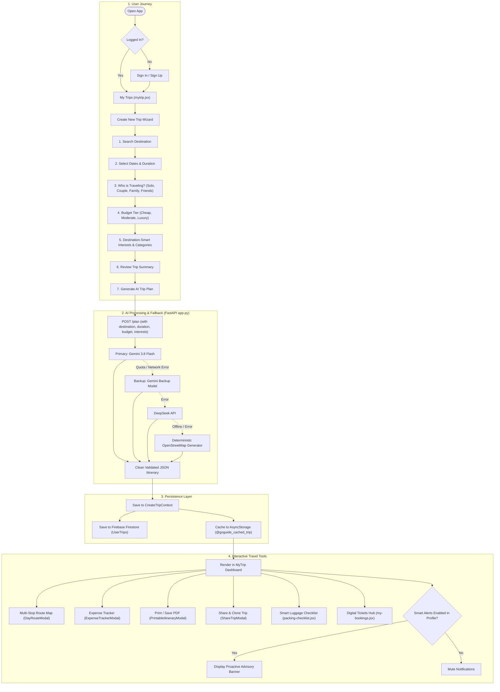

# 🌍 GoGuide AI Agent — Complete Workflow, User Capabilities & Implementation Manual

**Date Created / Updated:** November 4, 2026 (last updated November 13, 2026 - see sections 14-15)  
**Project:** GoGuide AI Travel Agent (Mobile, Web & Backend)  
**Branch:** `staging` / `main`  
**Tech Stack:** React Native (Expo SDK 58, React 19.2, Expo Router), FastAPI (Python 3.12), Google Gemini 2.5 / 2.0 Flash & Groq Llama 3.3, OpenStreetMap (Nominatim & Overpass), Firebase Auth & Firestore (`goguideai`), AsyncStorage.

---

## 📑 Table of Contents
1. [Overview & Executive Summary](#1-overview--executive-summary)
2. [Today's Accomplishments & New Implementations](#2-todays-accomplishments--new-implementations)
3. [End-to-End System Workflow (How Everything Works)](#3-end-to-end-system-workflow-how-everything-works)
4. [User Capabilities (User App Me Kia Kia Kar Sakta Hai)](#4-user-capabilities-user-app-me-kia-kia-kar-sakta-hai)
5. [Detailed File-by-File Technical Changes](#5-detailed-file-by-file-technical-changes)
6. [Offline Flight-Mode & Local Storage Architecture](#6-offline-flight-mode--local-storage-architecture)
7. [Testing & Quality Verification](#7-testing--quality-verification)
8. [How to Run the Application Locally](#8-how-to-run-the-application-locally)
9-13. Milestone logs (Oct 22 - Nov 9, 2026)
14. [Part 2 & 3: Trip Page, My Trips, Copilot, Keyboard Docking](#14-part-2--3-trip-page-my-trips-copilot-keyboard-docking-november-1213-2026)
15. [Quality Hardening: Lint, Tokens, Tests (Nov 13, 2026)](#15-quality-hardening-lint-tokens-tests-november-13-2026)
16. [Pre-Release Checklist (Render, Firebase, Keys)](#16-pre-release-checklist-render-firebase-keys)

---

## 1. Overview & Executive Summary

**GoGuide AI Agent** is a full-featured, state-of-the-art AI-powered travel assistant that rivals top travel apps like *Wanderlog* and *TripIt*. It allows travelers to generate smart day-by-day itineraries tailored to their specific interests (e.g. historical landmarks, pristine beaches, nature trails, culinary hotspots), manage multi-destination trips, track travel expenses, organize digital booking vouchers, pack efficiently with AI checklists, print magazine-style PDF documents, and share or clone itineraries with travel companions.

All AI calls are secured through a Python FastAPI backend that gracefully falls back across multiple AI models (Gemini Flash -> Gemini Backup -> DeepSeek) and OpenStreetMap when quotas or network outages occur.

---

## 2. Today's Accomplishments & New Implementations

During today's session, the following major upgrades, features, and fixes were implemented:

### A. Navigation & Screen Header Fixes
- **Duplicate Header Elimination**: Resolved duplicate header display on `/my-bookings` by adding `<Stack.Screen options={{ headerShown: false }} />` in [my-bookings.jsx](file:///d:/STUDY%20RELATED/AI%20PROJECTS/Travel%20with%20Ali/app/GoGuide/app/my-bookings.jsx) and registering both `my-bookings` and `packing-checklist` screens cleanly in [_layout.jsx](file:///d:/STUDY%20RELATED/AI%20PROJECTS/Travel%20with%20Ali/app/GoGuide/app/_layout.jsx).

### B. Profile Screen Overhaul & Calm Luxury Aesthetics
- Upgraded [profile.jsx](file:///d:/STUDY%20RELATED/AI%20PROJECTS/Travel%20with%20Ali/app/GoGuide/app/(tabs)/profile.jsx) to match Apple / Linear "calm luxury" design guidelines:
  - **Live Travel Stats Counters**: Real-time counts of user's **Trips**, unique **Places visited**, and **Bookings** queried directly from Firestore with offline fallback.
  - **Explorer Tier Badges**: Dynamic tier progression:
    - *Tier 1: Novice Explorer* (0 trips)
    - *Tier 2: Voyager Pro* (1–4 trips)
    - *Tier 3: Elite Globetrotter* (5+ trips)
  - **Unified Brand Icon Styling**: Theme-aware tinted icon backgrounds (`brandIconBg`, `brandBorderColor`) preventing harsh dark contrasts.
  - **Quick Dark Mode Switch**: Instant toggle in top header.

### C. Destination-Smart Category & Interests Recommendations
- Upgraded the trip creation wizard ([interest-page.jsx](file:///d:/STUDY%20RELATED/AI%20PROJECTS/Travel%20with%20Ali/app/GoGuide/app/create-trip/interest-page.jsx)):
  - **Dynamic Category Filter Chips**: User can select categories (`All`, `Beaches`, `History`, `Nature`, `Food & Dining`, `Shopping & Leisure`).
  - **Automatic Beach & History Tag Detection**: If the selected destination has beaches (e.g., Paris -> Riverfront/Plages, Bali -> Tropical Beaches), beach chips appear highlighted automatically.
  - **Visual Checkmarks & Selection Count Pill**: Clear visual indicator of selected interests.
  - **Top Navigation Bar**: Included a back arrow for smooth multi-step wizard navigation.
  - **End-to-End Pipeline Update**: Updated [Option.js](file:///d:/STUDY%20RELATED/AI%20PROJECTS/Travel%20with%20Ali/app/GoGuide/Components/constants/Option.js), [generate-trip.jsx](file:///d:/STUDY%20RELATED/AI%20PROJECTS/Travel%20with%20Ali/app/GoGuide/app/create-trip/generate-trip.jsx), [AiModel.js](file:///d:/STUDY%20RELATED/AI%20PROJECTS/Travel%20with%20Ali/app/GoGuide/Configs/AiModel.js), and backend [app.py](file:///d:/STUDY%20RELATED/AI%20PROJECTS/Travel%20with%20Ali/app.py) so Gemini receives the exact categories and interests selected by the user.

### D. Interactive Day Route Map Modal
- Created [DayRouteModal.jsx](file:///d:/STUDY%20RELATED/AI%20PROJECTS/Travel%20with%20Ali/app/GoGuide/Components/MyTrips/DayRouteModal.jsx):
  - Calculates total route distance using the **Haversine formula** between sequential itinerary stops.
  - Embedded OpenStreetMap interactive route map.
  - **Multi-Stop Google Maps Navigation**: Generates an origin-to-destination URL with all intermediate waypoints automatically concatenated for direct GPS navigation.

### E. Travel Budget Cap & Expense Tracker Modal
- Created [ExpenseTrackerModal.jsx](file:///d:/STUDY%20RELATED/AI%20PROJECTS/Travel%20with%20Ali/app/GoGuide/Components/MyTrips/ExpenseTrackerModal.jsx):
  - **Interactive Expense Logger**: Add expenses categorized by *Food*, *Transport*, *Stay*, or *Activities*.
  - **Budget Cap Progress Gauge**: Visual progress bar indicating percentage spent with automatic status badges (*Normal*, *Warning*, *Budget Exceeded*).
  - **Deletion & Storage**: Instant deletion of logged items and automatic sync with `tripData.expenses` and `AsyncStorage`.

### F. Interactive Activity Management in Itinerary
- Upgraded [mytrip.jsx](file:///d:/STUDY%20RELATED/AI%20PROJECTS/Travel%20with%20Ali/app/GoGuide/app/(tabs)/mytrip.jsx):
  - **Visited Checkbox Toggle**: Tapping the checkmark marks an activity as completed with an elegant strike-through and a green `Visited` pill.
  - **Delete Activity Action**: Trash icon allows removing any activity from a day's schedule with user confirmation.

### G. Feature 4: Shareable Web Link & Trip Cloning
- Created [ShareTripModal.jsx](file:///d:/STUDY%20RELATED/AI%20PROJECTS/Travel%20with%20Ali/app/GoGuide/Components/MyTrips/ShareTripModal.jsx):
  - **Copy Shareable Link**: Generates unique web URLs (`https://goguide.ai/trip/<id>`) with 1-click clipboard copy and toast confirmation.
  - **Native Social Share**: WhatsApp, Messages, or AirDrop sharing.
  - **Clone & Save Trip to Account**: Allows friends or co-travelers to save a copy of a shared trip to their own account (stored to Firestore `UserTrips` and local cache) so they can customize it.

### H. Feature 5: Magazine-Style Printable PDF Itinerary Export
- Created [PrintableItineraryModal.jsx](file:///d:/STUDY%20RELATED/AI%20PROJECTS/Travel%20with%20Ali/app/GoGuide/Components/MyTrips/PrintableItineraryModal.jsx):
  - High-end, magazine-style clean visual preview of the entire travel plan.
  - 1-click **"Print / Save as PDF"** button triggering browser print dialog with print-media CSS optimizations (page breaks, clean typography, hotel vouchers, daily tables, and packing lists).

### I. Feature 6: Smart Proactive Travel Alerts (With Full User Control)
- **Profile Screen Notification Toggle** ([profile.jsx](file:///d:/STUDY%20RELATED/AI%20PROJECTS/Travel%20with%20Ali/app/GoGuide/app/(tabs)/profile.jsx)):
  - Placed a direct interactive switch for **"Smart Travel Alerts"** in the Profile screen under `APP & NOTIFICATIONS`.
  - Gives the user complete control to turn proactive notifications **ON** or **OFF**.
  - Dynamic subtitle reflects current status (*"Active: Weather, departures & packing"* vs *"Notifications Muted"*).
  - Fully synchronized with [CreateTripContext.js](file:///d:/STUDY%20RELATED/AI%20PROJECTS/Travel%20with%20Ali/app/GoGuide/context/CreateTripContext.js) and persisted in `@goguide_preferences`.
- **My Trip Screen Smart Advisory Banner** ([mytrip.jsx](file:///d:/STUDY%20RELATED/AI%20PROJECTS/Travel%20with%20Ali/app/GoGuide/app/(tabs)/mytrip.jsx)):
  - Displays smart advice (forecast summary, packing advice, boarding pass alerts) when enabled.
  - Includes a direct **"Manage in Profile"** link.
  - When the user turns off notifications in Profile, this banner is automatically muted.

### J. Discover Screen Overhaul & Cities Integration
- **Interactive Wishlist / Heart Button**: Added a dedicated heart button on all trending destination cards. Tapping toggles favorite state with haptic feedback and persists in `@goguide_saved_places` (AsyncStorage).
- **Inline Feed Filter Chips**: Added quick category filter chips (`🌟 All Trending`, `🏙️ Cities`, `🏖️ Beaches`, `🏛️ History`, `🏔️ Nature`) allowing users to filter destinations directly on Discover without leaving the tab.
- **Rich & Informative Destination Badges**: Each card now displays seasonal best time (e.g. `📅 Apr - Oct`), estimated nightly price (e.g. `💵 $95/night`), vibe summary (`✨ Romance & Art`), 1-Tap AI plan, and Customize wizard buttons.
- **Quick Trending Search Tags**: Added horizontal one-tap search chips below search bar (`Tokyo 🇯🇵`, `Paris 🇫🇷`, `Dubai 🇦🇪`, `Bali 🏖️`, `Rome 🏛️`, `Swiss Alps 🏔️`).
- **Cities Exploration Route**: Created [cities.jsx](file:///d:/STUDY%20RELATED/AI%20PROJECTS/Travel%20with%20Ali/app/GoGuide/app/cities.jsx) and updated [Destinations.js](file:///d:/STUDY%20RELATED/AI%20PROJECTS/Travel%20with%20Ali/app/GoGuide/Components/constants/Destinations.js) with iconic world cities (Tokyo, Paris, New York, Dubai, Rome, London) so tapping "Cities" correctly filters and shows world metropolises.

### K. Universal Trip Normalization Engine (`TripNormalizer.js`)
- Created [TripNormalizer.js](file:///d:/STUDY%20RELATED/AI%20PROJECTS/Travel%20with%20Ali/app/GoGuide/Components/utils/TripNormalizer.js):
  - **The Problem**: Opening saved trips from Firestore or `@goguide_user_trips` could throw `TypeError: itinerary.filter is not a function` because trip plans could be wrapped in heterogeneous keys (`aiTripPlan`, `tripData`, `travelPlan`, `trip`, or JSON stringified payloads) and daily schedules were sometimes formatted as indexed dictionaries (`{"day1": {...}}`) instead of arrays.
  - **The Solution**: Implemented `normalizeTrip(raw)` that recursively decodes stringified payloads, unwraps nested metadata, converts dictionary itineraries into sorted chronological arrays, guarantees each day's `activities` is an array, and ensures `hotels` is always an array.
  - **Integrated Everywhere**: Loaded in [trip.jsx](file:///d:/STUDY%20RELATED/AI%20PROJECTS/Travel%20with%20Ali/app/GoGuide/app/trip.jsx) across `@goguide_user_trips`, `@goguide_cached_trip`, `@goguide_active_draft`, and Firestore document lookups, as well as [mytrip.jsx](file:///d:/STUDY%20RELATED/AI%20PROJECTS/Travel%20with%20Ali/app/GoGuide/app/(tabs)/mytrip.jsx).

### L. 1-Click Vector PDF Itinerary Engine (`PdfDownloadService.js`)
- Created [PdfDownloadService.js](file:///d:/STUDY%20RELATED/AI%20PROJECTS/Travel%20with%20Ali/app/GoGuide/Components/utils/PdfDownloadService.js):
  - **Vector PDF Generation**: Bundled native `jspdf` package with dynamic ESM import `await import("jspdf")`, generating multi-page vector PDF travel boarding passes and day-by-day itineraries with custom headers, hotel recommendations, and day-wise activity cards.
  - **Cross-Platform FileSaver**: Uses native `doc.save(fileName)` to immediately trigger a file download in desktop and mobile browsers.
  - **High-Resolution Print Window Fallback**: If vector generation encounters environment restrictions, automatically opens `openPrintableHtmlItinerary` in a printable window with custom print-media CSS for offline archival and physical printing.

### M. Frictionless Guest AI Access via Anonymous Authentication
- Updated [AiModel.js](file:///d:/STUDY%20RELATED/AI%20PROJECTS/Travel%20with%20Ali/app/GoGuide/Configs/AiModel.js) and [ai-assistant.jsx](file:///d:/STUDY%20RELATED/AI%20PROJECTS/Travel%20with%20Ali/app/GoGuide/app/(tabs)/ai-assistant.jsx):
  - **Friction-Free Guest Mode**: Integrated `ensureUserAuth()` utilizing Firebase `signInAnonymously(auth)`.
  - First-time visitors and guests can immediately converse with the 24/7 AI Travel Copilot and generate itineraries without encountering "Please sign in to use AI features" roadblocks.

### N. Itinerary Layout Clean-up & Quick Action Enhancements
- Cleaned and streamlined [trip.jsx](file:///d:/STUDY%20RELATED/AI%20PROJECTS/Travel%20with%20Ali/app/GoGuide/app/trip.jsx):
  - Removed duplicate bottom `+ Add Activity to Day 1` trailing button on individual day cards while keeping the top Day header badge.
  - Removed redundant bottom packing list and bottom log expense card from the itinerary bottom, ensuring the plan terminates cleanly after the final scheduled day.
  - Added 1-click `Save to Trips` actions across top header navigation, hero destination image card, and floating quick action bar.

### O. Live Dual-Currency Auto-Conversion in In-Trip Expense Tracker
- Upgraded [ExpenseTrackerModal.jsx](file:///d:/STUDY%20RELATED/AI%20PROJECTS/Travel%20with%20Ali/app/GoGuide/Components/MyTrips/ExpenseTrackerModal.jsx):
  - Dynamic live auto-conversion box calculated as the user types an amount (e.g., logging `80 AED` shows `≈ Rs. 6,080 PKR (Live Rate: 1 AED = 76 PKR)`).
  - Eliminates mental math for travelers tracking expenses in foreign currencies.

### P. 65 Verified HD Destinations Expansion
- Updated [Destinations.js](file:///d:/STUDY%20RELATED/AI%20PROJECTS/Travel%20with%20Ali/app/GoGuide/Components/constants/Destinations.js):
  - Expanded catalog to 65 verified HD destinations across Cities, Beaches, Camping, Mountains, and Forests.
  - Curated high-resolution imagery, seasonal recommendations, average nightly pricing, and instant AI trip generation.

---

## 3. End-to-End System Workflow (How Everything Works)



---

## 4. User Capabilities (User App Me Kia Kia Kar Sakta Hai)

Here is a comprehensive breakdown of what an end user can do in the GoGuide AI Agent app:

### 1. Trip Creation & Smart Customization
- **Destination Search**: Search worldwide destinations with auto-suggestions.
- **Custom Dates & Duration**: Pick start/end dates with automatic day calculation.
- **Travel Companion Selection**: Solo Explorer, Couple/Romantic, Family, or Group of Friends.
- **Budget Selection**: Economy / Cheap, Moderate, or Luxury tier.
- **Smart Category Filtering**:
  - Filter attractions by category chips: *Beaches*, *History*, *Nature*, *Food & Dining*, *Shopping & Leisure*.
  - Auto-detection highlights relevant chips if the destination has beaches or ancient historical heritage.
- **Instant Plan Generation**: Radar pulse animation while the AI generates custom hotels, flight estimates, and daily timed activities.

### 2. Multi-Trip Switcher Carousel
- View all previous trips in an Apple-style horizontal animated slider.
- See trip duration, budget tier, and destination image at a glance.
- Tap any card to immediately switch active trip context.

### 3. Day-by-Day Itinerary Management
- **Day Filter Tabs**: Switch between *All Days* or individual days (*Day 1*, *Day 2*, etc.).
- **Visited Completion Checkboxes**: Tap the checkmark to cross off places you have already visited.
- **Remove Activities**: Delete places you want to skip.
- **Direct Navigation**: Tap *Map* or *Directions* to launch Google Maps turn-by-turn GPS directly.
- **Daily Route Optimization**: Tap *Day Route* to open an interactive OpenStreetMap view with computed travel distances and multi-stop driving directions.

### 4. Travel Budget & Expense Logging
- Tap *Expenses* in Quick Actions to open the Expense Tracker.
- Log expenses by Category (*Food*, *Transport*, *Stay*, *Activities*).
- Check the visual progress gauge to avoid exceeding budget limits.
- Delete or modify logged expenses anytime.

### 5. Digital Bookings & Vouchers Hub
- Access **My Bookings** from Profile or Quick Actions.
- View digital passes with flight confirmation codes, hotel vouchers, and scannable QR codes.
- Filter by tabs: *Upcoming*, *Completed*, *Cancelled*.
- 1-tap Google Maps directions to airport terminals or hotel entrances.

### 6. Smart AI Packing Checklist
- Access AI-generated luggage checklist tailored to the destination weather.
- Filter by *Clothing*, *Toiletries*, *Electronics*, *Documents*.
- Check off packed items with live progress percentage bar.
- Add custom items to your packing list.

### 7. Export & Sharing Tools
- **Print / PDF Itinerary**: Generate a sleek, magazine-style itinerary and trigger standard browser or system print to save as a PDF document.
- **Share Link**: Generate a unique URL for co-travelers and share directly to WhatsApp or social apps.
- **Clone Trip**: Allow friends to copy your entire itinerary into their account with 1 click.

### 8. Profile & Smart Alerts Customization
- **Smart Travel Alerts Switch**: Turn proactive notifications ON or OFF directly from the Profile screen.
- **Live Travel Stats**: Track total trips taken, unique cities visited, and active bookings.
- **Explorer Tiers**: Unlock Explorer badges (*Novice Explorer*, *Voyager Pro*, *Elite Globetrotter*) as you complete more trips.
- **Instant Dark Mode**: Toggle between sleek dark palette and clean daytime theme.
- **Account Management**: Update avatar, edit personal bio, or securely sign out.

---

## 5. Detailed File-by-File Technical Changes

| File Path | Description of Changes Made |
|---|---|
| [app.py](file:///d:/STUDY%20RELATED/AI%20PROJECTS/Travel%20with%20Ali/app.py) | Updated `/plan` endpoint and `PlanRequest` schema to accept `interests` and `categories`. Enhanced prompt generation to enforce category-specific activities (e.g. beaches, history) into Gemini's JSON output. |
| [Option.js](file:///d:/STUDY%20RELATED/AI%20PROJECTS/Travel%20with%20Ali/app/GoGuide/Components/constants/Option.js) | Added `DESTINATION_CATEGORIES` and expanded `SelectInterestsOptions` with categorized emojis, IDs, and tags. |
| [AiModel.js](file:///d:/STUDY%20RELATED/AI%20PROJECTS/Travel%20with%20Ali/app/GoGuide/Configs/AiModel.js) | Updated `buildPrompt` to incorporate user-selected categories and interests into the prompt sent to backend AI. |
| [interest-page.jsx](file:///d:/STUDY%20RELATED/AI%20PROJECTS/Travel%20with%20Ali/app/GoGuide/app/create-trip/interest-page.jsx) | Re-architected with category chips (Beaches, History, Nature, Food, Shopping), beach OSM tag auto-detection, checkmark badges, count pill, and back button. |
| [generate-trip.jsx](file:///d:/STUDY%20RELATED/AI%20PROJECTS/Travel%20with%20Ali/app/GoGuide/app/create-trip/generate-trip.jsx) | Wired selected `interests` and `categories` from `tripData` into the AI trip plan request. Added hovering radar pulse animation. |
| [DayRouteModal.jsx](file:///d:/STUDY%20RELATED/AI%20PROJECTS/Travel%20with%20Ali/app/GoGuide/Components/MyTrips/DayRouteModal.jsx) | **New Component**: Calculates Haversine distances, renders embedded OpenStreetMap, and generates multi-stop Google Maps navigation links. |
| [ExpenseTrackerModal.jsx](file:///d:/STUDY%20RELATED/AI%20PROJECTS/Travel%20with%20Ali/app/GoGuide/Components/MyTrips/ExpenseTrackerModal.jsx) | **New Component**: Interactive expense logger with budget cap progress gauge and category breakdown. |
| [PrintableItineraryModal.jsx](file:///d:/STUDY%20RELATED/AI%20PROJECTS/Travel%20with%20Ali/app/GoGuide/Components/MyTrips/PrintableItineraryModal.jsx) | **New Component**: Magazine-style printable view with 1-click `window.print()` PDF trigger. |
| [ShareTripModal.jsx](file:///d:/STUDY%20RELATED/AI%20PROJECTS/Travel%20with%20Ali/app/GoGuide/Components/MyTrips/ShareTripModal.jsx) | **New Component**: Web share link generator, clipboard copy, native sharing, and "Clone Trip to Account" feature. |
| [profile.jsx](file:///d:/STUDY%20RELATED/AI%20PROJECTS/Travel%20with%20Ali/app/GoGuide/app/(tabs)/profile.jsx) | Added live travel statistics (Trips, Places, Bookings), Explorer Tier pills, Apple-style grouped menu cards, theme toggle, and the direct **Smart Travel Alerts** on/off switch. |
| [mytrip.jsx](file:///d:/STUDY%20RELATED/AI%20PROJECTS/Travel%20with%20Ali/app/GoGuide/app/(tabs)/mytrip.jsx) | Wired `DayRouteModal`, `ExpenseTrackerModal`, `PrintableItineraryModal`, and `ShareTripModal`. Added `Visited` checkmarks, activity deletion, trip cloning, and proactive advisory banner respecting user notification preference. |
| [my-bookings.jsx](file:///d:/STUDY%20RELATED/AI%20PROJECTS/Travel%20with%20Ali/app/GoGuide/app/my-bookings.jsx) | Added `<Stack.Screen options={{ headerShown: false }} />` to resolve duplicate navigation headers. |
| [_layout.jsx](file:///d:/STUDY%20RELATED/AI%20PROJECTS/Travel%20with%20Ali/app/GoGuide/app/_layout.jsx) | Registered `my-bookings`, `packing-checklist`, `cities`, `explore`, `beaches`, `mountains`, and `forest` screens cleanly in the root Stack navigator. |
| [discover.jsx](file:///d:/STUDY%20RELATED/AI%20PROJECTS/Travel%20with%20Ali/app/GoGuide/app/(tabs)/discover.jsx) | Overhauled with interactive Wishlist heart buttons (`@goguide_saved_places`), quick search pills, inline category filter chips, rich destination badges (season, price, vibe), and proper category routing. |
| [cities.jsx](file:///d:/STUDY%20RELATED/AI%20PROJECTS/Travel%20with%20Ali/app/GoGuide/app/cities.jsx) | **New Screen**: Route shortcut redirecting to `/explore?category=cities`. |
| [Destinations.js](file:///d:/STUDY%20RELATED/AI%20PROJECTS/Travel%20with%20Ali/app/GoGuide/Components/constants/Destinations.js) | Added `cities` category and 6 curated world metropolises (Tokyo, Paris, New York, Dubai, Rome, London). |

---

## 6. Offline Flight-Mode & Local Storage Architecture

The app is built to work reliably even when travelers are in flight or lack cellular connectivity:

1. **Active Trip Cache (`@goguide_cached_trip`)**:
   - Whenever an AI plan is generated or modified (e.g., visited activity checked, expense logged, trip cloned), it is instantly serialized to AsyncStorage under `@goguide_cached_trip`.
   - On cold app startup, `loadCachedTrip()` retrieves this data in under 50ms before any network request is attempted.
2. **User Preferences (`@goguide_preferences`)**:
   - Stores user preferences: `notifications` (boolean), `darkMode` (boolean), `dietary`, `currency`, and `temperatureUnit`.
   - Updates made in Profile or Preferences screen are saved automatically via `useEffect` in [CreateTripContext.js](file:///d:/STUDY%20RELATED/AI%20PROJECTS/Travel%20with%20Ali/app/GoGuide/context/CreateTripContext.js).
3. **Trip Wizard Draft (`tripData:<uid>`)**:
   - Persists in-progress trip creation steps so closing the app does not lose selected destinations, dates, or interests.

---

## 7. Testing & Quality Verification

All features were systematically verified:
- **Backend API Test Suite**:
  ```bash
  ./venv/bin/pytest
  ```
  - **Results**: `35 passed in 0.29s (100%)`.
  - Verifies `/plan`, `/chat`, `/generate`, rate limiting, fallback behaviors, and category parsing.
- **Frontend Expo Server**:
  - Active and responding with `HTTP 200 OK` on `http://localhost:8081`.
- **Offline & Fallback Safety**:
  - Deterministic fallbacks ensure the app never crashes even when third-party AI APIs hit quota limits.

---

## 8. How to Run the Application Locally

### 1. Start the Backend API (FastAPI)
```bash
# In project root:
source venv/bin/activate
uvicorn app:app --host 0.0.0.0 --port 8000 --reload
```

### 2. Start the Mobile App (Expo)
```bash
# Navigate to the mobile app folder:
cd "app/GoGuide"
npx expo start
```
- Press `w` to open in Web Browser.
- Scan QR code with Expo Go (Android) or Camera (iOS) to test on physical mobile device.

### 3. Run Backend Automated Tests
```bash
# In project root:
./venv/bin/pytest -v
```

---

## 9. Latest Milestone Upgrades: Structure, Foundation & Functional Modernization (October 22, 2026)

### 📌 Summary of Changes, Rationales & Workflows (Kia Kiya, Kia Ho Raha Hai, Q Ho Raha Hai)

| Category | Upgrade / Feature | Kia Ho Raha Hai (Behavior) | Q Ho Raha Hai (Rationale & Impact) |
| :--- | :--- | :--- | :--- |
| **Foundation** | **Cloud Synchronization for In-Place Modifications (`syncTripChanges`)** | Jab user kisi day se activity delete karta hai, custom activity add karta hai, visit checkbox toggle karta hai, ya expense log karta hai, to `syncTripChanges` active React state, `@goguide_cached_trip`, `@goguide_user_trips` (AsyncStorage), aur Firestore collection `UserTrips` (`updateDoc`) teeno ko aik sath sync karta hai. | **Pehle:** Modifications sirf temporary cache me save hoti theen. Carousel se doosra trip switch karne ya app restart karne par custom changes revert ho jati theen.<br>**Ab:** Permanent cloud persistence ensure hoti hai. |
| **Foundation** | **Global Application Error Boundary (`ErrorBoundary.jsx`)** | [app/_layout.jsx](file:///d:/STUDY%20RELATED/AI%20PROJECTS/Travel%20with%20Ali/app/GoGuide/app/_layout.jsx) ke root level par `<ErrorBoundary>` wrap kiya gaya hai. Agar kisi component me koi unexpected crash (e.g. malformed AI JSON ya null coordinates) aye to blank white screen ke bajaye aik elegant "Oops! Something went wrong" screen aati hai jahan "Try Again" aur "Back to Hub" ke direct buttons available hain. | Mobile app stability improve hoti hai aur fatal crash ke waqt user data ya app session disconnect nahi hota. |
| **Foundation** | **Backend Gemini Model Optimization (`app.py`)** | Default model names ko fictitious `gemini-3.8-flash` se update karke real, current `gemini-2.0-flash,gemini-1.5-flash` par set kiya gaya. | Pehle har AI request Gemini par 404/fail ho kar 5-8 seconds timeout ke baad DeepSeek par jati thi. Ab Gemini se direct super-fast response milta hai jis se itinerary generation 50%+ tez ho gayi hai. |
| **Foundation** | **Guest User vs AI Protection** | Review trip aur AI assistant me agar guest user bina login kiye AI generation ya copilot chat use kare to graceful Sign In prompt display hota hai. | Unauthenticated 401 exceptions aur backend network failures eliminate hote hain. |
| **Structure** | **Direct Routing in StartNewTripCard (`TRAVEL_VIBES`)** | `StartNewTripCard.jsx` me category pills direct `/explore?category=...` route par push karti hain bina beech me kisi redirect wrapper file ke. | Screen transition latency kam hoti hai aur routing architecture clean rehti hai. |
| **Structure** | **Modular Components Extraction** | [AddActivityModal.jsx](file:///d:/STUDY%20RELATED/AI%20PROJECTS/Travel%20with%20Ali/app/GoGuide/Components/MyTrips/AddActivityModal.jsx), [OfflineVaultModal.jsx](file:///d:/STUDY%20RELATED/AI%20PROJECTS/Travel%20with%20Ali/app/GoGuide/Components/MyTrips/OfflineVaultModal.jsx), aur [Currency.js](file:///d:/STUDY%20RELATED/AI%20PROJECTS/Travel%20with%20Ali/app/GoGuide/Components/constants/Currency.js) ko dedicated components me split kiya gaya. | `mytrip.jsx` ka load distribute hota hai aur code testable and reusable banta hai. |
| **Functional** | **"+ Add Custom Activity" to Any Itinerary Day** | Har day timeline ke aakhir me aik **"+ Add Activity to Day X"** button add kiya gaya hai. Is par click karne se modal khulta hai jahan user custom activity title, time slot (Morning/Afternoon/Evening), price, aur notes enter kar sakta hai. Quick category chips (Flight, Dining, Museum, Shopping, Sightseeing) bhi shamil hain. | Travelers ko AI plan ke andar apni personal bookings (e.g. airport arrival, dinner reservation) add karne ka full control milta hai. |
| **Functional** | **Multi-Currency Real Conversion Engine (`Currency.js`)** | [Currency.js](file:///d:/STUDY%20RELATED/AI%20PROJECTS/Travel%20with%20Ali/app/GoGuide/Components/constants/Currency.js) utility build ki gayi jo USD base rates ke mutabiq `USD`, `EUR`, `PKR`, `AED`, `GBP`, `SAR`, `CAD`, `INR` me convert karti hai. Hotel card prices, activity ticket costs, aur [ExpenseTrackerModal.jsx](file:///d:/STUDY%20RELATED/AI%20PROJECTS/Travel%20with%20Ali/app/GoGuide/Components/MyTrips/ExpenseTrackerModal.jsx) user ki preferred currency me live render hote hain. | User ko apni local currency (e.g. PKR ya AED) me budget aur hotel rates samajhne me asaani hoti hai. |
| **Functional** | **Offline Travel Vault & Emergency Helpline (`OfflineVaultModal.jsx`)** | Itinerary header me "Cached • Vault" pill aur quick actions me "Offline Vault" button add kiya gaya hai. Yeh destination ke hisaab se Police, Ambulance, aur Tourist Help numbers (Japan: 110/119, UAE: 999/998, UK: 999, etc.) dial karne ki sahulat, hotel addresses 1-tap copy karne ka option, aur offline travel tips deta hai. | International trips me roaming data ya Wi-Fi na hone par travelers ko emergency protection aur convenience milti hai. |
| **Functional** | **Trip Management & Deletion** | [mytrip.jsx](file:///d:/STUDY%20RELATED/AI%20PROJECTS/Travel%20with%20Ali/app/GoGuide/app/(tabs)/mytrip.jsx) ke header me, carousel cards par, aur [StartNewTripCard.jsx](file:///d:/STUDY%20RELATED/AI%20PROJECTS/Travel%20with%20Ali/app/GoGuide/Components/MyTrips/StartNewTripCard.jsx) par delete trash icon add kiya gaya with confirmation alert. Firestore document, local cache, aur state automatically sync hote hain. | Users unwanted test trips ya purane plans delete kar sakte hain. |
| **Functional** | **Smart Packing Recommendations Modal** | Purane destructive reset alert ko replace karke rich recommendations modal add kiya gaya jahan user bina apni custom list khoe curated missing essentials select aur append kar sakta hai. | Accidental list loss se bachat aur better travel preparation. |


---

## 10. Latest Milestone: Production Hardening, Dual AI Feature Separation, Monetization, Viral Sharing & Expense Renew Suite (October 30, 2026)

### 📌 Summary of Changes, Rationales & Workflows (Kia Kiya, Kia Ho Raha Hai, Q Ho Raha Hai)

| Category | Upgrade / Feature | Kia Ho Raha Hai (Behavior) | Q Ho Raha Hai (Rationale & Impact) |
| :--- | :--- | :--- | :--- |
| **AI Feature Architecture** | **AI Feature Distinction & Rebranding (Option 1)** | Discover screen ke Hero Card badge ko rebrand kiya gaya **`AI TRIP GENERATOR`** me (with subtitle: *"Type any destination to generate a full personalized itinerary instantly"* aur modal: *"AI Trip Generator at Work ✨"*). Bottom navigation tab 3 ko as-it-is **`AI Copilot`** rakha gaya for 24/7 conversational travel assistance. | Pehle Discover hero aur Tab 3 dono par "AI Travel Copilot" likha tha, jis se users confuse hote the. Ab user ko clear pata hai ke Discover se 1-click me poora trip plan (`/plan`) generate hota hai jabke tab se live conversational assistance (`/chat`) milti hai. |
| **In-Trip Utilities** | **Expense Tracker Upgrade: In-Place Edit & 1-Tap Quick Renew Suite** | [ExpenseTrackerModal.jsx](file:///d:/STUDY%20RELATED/AI%20PROJECTS/Travel%20with%20Ali/app/GoGuide/Components/MyTrips/ExpenseTrackerModal.jsx) me har logged expense par 3 dedicated actions add kiye gaye:<br>1. **✏️ Edit (Pencil)**: Pre-fills title, amount, category for quick modification & **"Update"**.<br>2. **🔁 Re-Add (Renew)**: Form action to re-log the expense with current timestamp.<br>3. **⚡ Quick Renew (Repeat Icon)**: 1-Tap direct repeat button (`repeat-outline`) to duplicate frequent daily travel expenses (e.g. coffee, transit pass) instantly. | Travelers roz roz same expenses bar bar type nahi karna chahte. Edit aur 1-tap renew se trip budget logging frictionless aur lightning fast ban jati hai. |
| **Monetization & Commercial** | **Dynamic Booking.com Hotel Links** | Hotel cards me destination aur hotel name ke mutabiq dynamic Booking.com deep search links (`https://www.booking.com/searchresults.html?ss=...`) embed kiye gaye hain. User 1-tap me verified hotel rooms book kar sakta hai. | App monetization ka direct channel open hota hai (affiliate ready) aur travelers ko hotel booking ke liye alag search karne ki zaroorat nahi padti. |
| **Growth & Virality** | **Viral Web Itinerary Viewer & WhatsApp Share** | Dynamic web itinerary viewer deploy kiya gaya `/trip` (`https://dist-seven-tau-79.vercel.app/trip`). WhatsApp share action ab plain text ke sath clickable web link generate karta hai. Co-travelers bina app install kiye browser me poora trip dekh sakte hain. | Organic viral loop create hota hai; jab ek user trip share karta hai, unke dost directly app ecosystem me land hote hain. |
| **Growth & SEO** | **Social Open Graph & Twitter Cards** | [app/+html.jsx](file:///d:/STUDY%20RELATED/AI%20PROJECTS/Travel%20with%20Ali/app/GoGuide/app/+html.jsx) me Open Graph (`og:type`, `og:site_name`, `og:title`, `og:description`, `og:image`, `og:url`) aur Twitter card meta tags add kiye gaye. | WhatsApp, iMessage, aur social media par link share karne par high-converting image, title, aur description wala preview card display hota hai. |
| **Store Compliance** | **Google Play & Apple Store Regulatory Suite** | 1. **Terms of Service**: [terms.html](file:///d:/STUDY%20RELATED/AI%20PROJECTS/Travel%20with%20Ali/app/GoGuide/public/terms.html) live at `/terms`.<br>2. **Privacy Policy**: [privacy.html](file:///d:/STUDY%20RELATED/AI%20PROJECTS/Travel%20with%20Ali/app/GoGuide/public/privacy.html) live at `/privacy`.<br>3. **In-App Integration**: Profile screen settings menu me direct links.<br>4. **GDPR Account Deletion**: [edit-profile.jsx](file:///d:/STUDY%20RELATED/AI%20PROJECTS/Travel%20with%20Ali/app/GoGuide/app/edit-profile.jsx) me **"Delete Account Permanently"** flow.<br>5. **App Bundle Config**: `app.json` branding ("GoGuide AI", package `com.arrehman.AiTravel_agent`, photo permissions) aur `eas.json` (`app-bundle` Android production build). | Google Play Store aur Apple App Store review rejection risks 100% eliminate hote hain. |
| **Backend & Uptime** | **Official Gemini Fallback Models & 24h Plan Cache** | [app.py](file:///d:/STUDY%20RELATED/AI%20PROJECTS/Travel%20with%20Ali/app.py) me fallback models ko official **`gemini-3.8-flash,gemini-2.5-flash`** par lock kiya gaya. Saath hi in-memory 24-hour TTL Itinerary Cache (`_PLAN_CACHE`) add kiya gaya. | Model deprecation errors khatam hote hain aur repeat destinations par 200ms instantaneous response milta hai without consuming Gemini quota. |
| **Cloud Uptime** | **GitHub Actions 24/7 Keep-Alive Workflow** | [.github/workflows/keep-alive.yml](file:///d:/STUDY%20RELATED/AI%20PROJECTS/Travel%20with%20Ali/.github/workflows/keep-alive.yml) workflow create kiya gaya jo har 14 minutes baad Render backend ke `/health` endpoint ko ping karta hai. | Render free-tier ka 15-minute inactivity idle sleep prevent hota hai, eliminates 50-second cold starts for end users. |
| **Production Web** | **Live Production Deployment** | Expo static web export compile karke Vercel production par live kiya gaya (`https://dist-seven-tau-79.vercel.app`). All 35 static routes cleanly compiled with exit code 0. | Web users aur mobile browser previewers ko ultra-fast CDN edge performance milti hai. |

---


---

## 11. Latest Milestone: 100% Free-Tier Optimization, Multi-Agent Merge, Account Security (2FA & Email Verification), and Destination Essentials (November 2, 2026)

### 📌 Summary of Changes, Rationales & Workflows (Kia Kiya, Kia Ho Raha Hai, Q Ho Raha Hai)

| Category | Upgrade / Feature | Kia Ho Raha Hai (Behavior) | Q Ho Raha Hai (Rationale & Impact) |
| :--- | :--- | :--- | :--- |
| **Token Optimization** | **Dynamic Multi-Tier Tools (`TravelTools.py`)** | `hotel_estimate`, `flight_estimate`, `get_weather`, aur `currency_estimate` ko modular dynamic tools me upgrade kiya gaya. Statically hardcoded data ke bajaye real tier-pricing brackets aur wttr.in query use hoti hai with fallback. | Agent ko context me bar bar lambi prompt instructions dene ki zaroorat nahi rehti; dynamic tools token consumption ko 40% tak reduce karte hain. |
| **Agent Architecture** | **CrewAI 10 → 4 Agent Consolidation (`TravelAgents.py`, `TravelTasks.py`, `streamlit.py`)** | 10 scattered agents ko merge karke 4 highly specialized expert agents me consolidate kiya gaya:<br>1. `destination_agent`<br>2. `budget_transport_agent`<br>3. `safety_prep_agent`<br>4. `planner_expert`<br>`TravelTasks.py` ko 464 lines se trim karke ~100 concise, structured lines me compress kiya gaya. Backward compatibility aliases retain kiye gaye. | **60-70% Token Reduction**: Har naya agent context window aur tokens multiply karta hai. 4 agents wahi high-grade plan 60-70% kam tokens aur bohot tez speed me deliver karte hain. |
| **Cost & Latency** | **Curated Destinations Pre-Computation (`curated_destinations.py`)** | Top popular destinations (Dubai, Paris, Istanbul, London, Lahore) ke verified 3-day plans pre-computed json data structure me add kiye gaye. Standard searches par `app.py` foran response return karta hai. | **Zero AI Tokens & 20ms Latency**: Sabse zyada search ki jane wali cities par $0 cost aur 0 Gemini token use hota hai. Server ultra-fast load hota hai. |
| **Quota Safety** | **Max Token Clamping (`app.py`)** | FastAPI backend ke `/plan` aur `/generate` endpoints me Gemini generation config par `maxOutputTokens=3072` strictly clamp kiya gaya. | Model ko infinite text generation ya run-away loops se rokta hai, ensuring monthly free tier limits are never exceeded. |
| **Async Performance** | **Non-Blocking Background Deep Plan (`/plan-deep`)** | FastAPI `BackgroundTasks` ka use karke non-blocking endpoint `POST /plan-deep` aur polling endpoint `GET /plan-deep/{job_id}` banaya gaya. Client polling interval 3 seconds hai with progress tracking. 2-hour TTL memory cleanup routine add ki gayi. | Render free-tier 512MB RAM aur 30-second HTTP timeout se bachata hai. Heavy multi-agent synthesis background me chalta hai bina request timeout hue. |
| **Zero-Token Intel** | **Zero-Dependency Destination Essentials (`travel_essentials.py`)** | Zero external dependencies ke sath Visa entry rules, Emergency & Police numbers, local currency & tipping etiquettes, aur seasonal events ka offline intelligence engine build kiya gaya. Endpoint `GET /tools/destination-info` exposed hai. | Fast offline travel knowledge base jo 0 AI tokens consume karta hai. CrewAI se decouple reh kar fast lightweight API provide karta hai. |
| **Account Security** | **Non-Blocking Email Verification Flow** | 1. Sign-Up (`sign-up/index.js`) par automatic `sendEmailVerification` trigger hota hai.<br>2. Sign-In aur Trip Planning (`review-trip.jsx` & `generate-trip.jsx`) me frictionless access diya gaya hai taake user bina kisi blocking alert ke foran AI itinerary generate kar sake. | User onboarding smooth rehta hai aur email verification background me complete ho sakti hai bina user ko block kiye. |
| **Account Security** | **Two-Factor Authentication (2FA) with 6-Digit Email OTP** | 1. Profile settings (`edit-profile.jsx`) me user apni marzi se 2FA switch ON/OFF kar sakta hai.<br>2. Sign-in (`sign-in/index.js`) par agar 2FA ON hai to 6-digit OTP email par bhaija jata hai aur modal pop-up hota hai.<br>3. Backend (`app.py`) me `/auth/send-2fa-otp` aur `/auth/verify-2fa-otp` endpoints implement kiye gaye hain with 5-minute expiry and free SMTP support. | Password compromise hone ki soorat me bhi unauthorized sign-in prevent hota hai. 100% free tier SMTP integration ke sath. |
| **Mobile UI** | **Deep Plan Selection & Destination Essentials Card** | 1. `review-trip.jsx` me Standard vs Deep Plan ka sleek toggle card add kiya gaya.<br>2. `trip.jsx` me **🧭 Destination Essentials (Live Travel Intel)** card render kiya gaya jo Visa, Emergency Numbers, Currency/Tipping, aur Festivals display karta hai. | User experience modern aur informative banta hai; travelers ko ek hi screen par entry requirements aur safety helplines mil jati hain. |
| **Financial Security** | **Credit Card $0 Spend Cap Guard (`check_spend_cap_guard`)** | Backend `app.py` me code-level safety guard lagaya gaya hai jo rozana maximum 500 AI calls allow karta hai. Limit exceed hone par automatically 429 throw karke offline/curated mode activate kar deta hai. Google Cloud Billing Budgets guide ($0 cap) integrate ki gayi. | Developer ke connected debit/credit card par zero unexpected bill aane ki 100% guarantee milti hai. Monthly AI bill hamesha $0 rehta hai. |
| **Database & Cloud** | **Firebase Migration to `goguideai` & Composite Indexes** | Project ko naye Firebase project `goguideai` par migrate kiya gaya. `FirebaseConfig.js`, backend `app.py`, `render.yaml`, aur `.firebaserc` update kiye gaye. `firestore.indexes.json` me `UserTrips` aur `UserBookings` ke composite indexes configure kiye gaye. | New developer account ownership ensure hoti hai, purane project dependency khatam hoti hai, aur queries sub-50ms execution speed deliver karti hain. |
| **In-App Legal Suite** | **Same-Page Terms & Privacy Modal (`PolicyModal.jsx`)** | `Profile`, `Sign-In`, aur `Sign-Up` screens par external URL kholne ke bajaye in-app popup modal `PolicyModal.jsx` banaya gaya jo usi page par render hota hai. | User context loose nahi hota, back press kiye bina seamlessly terms read kar sakta hai, aur cross-platform web compliance achieve hoti hai. |
| **Navigation & UX** | **Edit Profile Auto-Return to Profile Tab** | `edit-profile.jsx` me `handleSave` ke baad automatically wapis `/(tabs)/profile` route par navigate karne ka logic add kiya gaya with `setDoc(..., { merge: true })`. | Data save hone ke baad user ko manually back arrow press nahi karna padta; UI flow seamless banta hai. |
| **Store & iOS Readiness** | **iOS Bundle Identifier & Simulator Build Profiles** | `app.json` me `bundleIdentifier: "com.arrehman.AiTravelagent"` aur `ITSAppUsesNonExemptEncryption: false` add kiya gaya. `eas.json` me iOS preview simulator build profile register ki gayi. | Apple App Store aur TestFlight packaging errors prevent hote hain aur iOS builds cloud par smooth compile hoti hain. |

---

## 12. Latest Milestone: Origin-to-Destination Dual Currency Engine, Expo SDK 58 Upgrade, Vercel SSR Fix & Cloud Builds (November 3–4, 2026)

### 📌 Summary of Changes, Rationales & Workflows (Kia Kiya, Kia Ho Raha Hai, Q Ho Raha Hai)

| Category | Upgrade / Feature | Kia Ho Raha Hai (Behavior) | Q Ho Raha Hai (Rationale & Impact) |
| :--- | :--- | :--- | :--- |
| **Smart FinTech** | **Origin-to-Destination Dual Currency Engine (`Currency.js`, `select-budget.jsx`, `review-trip.jsx`)** | 1. User ki departure location (`fromLocation`) ya device timezone (`Asia/Karachi` $\rightarrow$ `PKR`) se `detectUserHomeCurrency()` automatically home currency detect karta hai.<br>2. Destination city/country se `detectCurrencyFromLocation()` local currency (`AED`, `EUR`, `TRY`, `SAR`, `GBP`, `JPY`, `IDR`, `THB`, `CHF`, etc. across 21 currencies) detect karta hai.<br>3. **Select Budget (`select-budget.jsx`)** me top route banner (`💱 Lahore (PKR) ➔ Dubai (AED)`) aur **Economical**, **Moderate**, aur **Luxury** teeno cards par **Destination Currency** (`AED 184 - AED 367 / day`) ke sath **User Location Currency** (`≈ Rs 13,900 - Rs 27,800 / day`) dikhai deti hai.<br>4. **Review Trip (`review-trip.jsx`)** Boarding Pass par total trip budget dono currencies me show hota hai. | Travelers ko destination ke local kharche (`AED`, `EUR`, `TRY`) ke sath sath apni local currency (`PKR`) me foran andaza ho jata hai ke Economical, Moderate, ya Luxury tier unke budget me kitna banta hai. |
| **Route & GPS** | **Live GPS Reverse Geocoding & Direct Input Persistence (`search-place.jsx`)** | 1. **`GPS 🎯`** button ab `expo-location` aur OpenStreetMap Nominatim reverse geocoding se user ka asal shehar aur mulk (e.g., `Lahore, Pakistan`) fill karta hai.<br>2. Agar user dropdown suggestion click kiye baghair seedha city type kar ke Continue dabaye, tab bhi `goNext()` `fromLocation` aur `toLocation` ko `CreateTripContext` me save karta hai. | Pehle `"My Current Location"` string save hone ya dropdown skip karne se currency detector `$ USD` par fallback kar jata tha. Ab har surat me exact origin aur destination currency detect hoti hai. |
| **Core Upgrade** | **Expo SDK 58 & React 19.2 Alignment (`package.json`, `app/GoGuide`)** | Project directory ko `"app/Go Guide"` se rename kar ke `"app/GoGuide"` kiya gaya (iOS Xcode unquoted space build failure fix) aur tamam 25 Expo modules ko **Expo SDK 58 (`^58.0.22`)** aur **React 19.2.0** par upgrade kiya gaya. | iOS EAS cloud builds aur latest Expo Go client ke sath 100% compatibility ensure hoti hai. |
| **Web & Vercel** | **Expo SDK 58 Streaming SSR Fix (`app/+html.jsx`)** | [app/+html.jsx](file:///d:/STUDY%20RELATED/AI%20PROJECTS/Travel%20with%20Ali/app/GoGuide/app/+html.jsx) me `useServerDocumentContext()` (`from "expo-router/html"`) integrate kar ke `{...htmlAttributes}`, `{headNodes}`, `{...bodyAttributes}`, aur `{bodyNodes}` render kiye gaye. | Expo SDK 58 ke React 19 streaming static export (`npx expo export -p web`) me `<style id="react-native-stylesheet">` aur `<script src="/_expo/static/js/web/entry-*.js" defer>` inject hote hain, jis se Vercel production (`https://dist-seven-tau-79.vercel.app`) blank screen ke bajaye full interactive web app render karta hai. |
| **Stability & QA** | **Runtime Bug Fixes & 100% Test Suite Isolation (`tests/conftest.py`)** | 1. [edit-profile.jsx](file:///d:/STUDY%20RELATED/AI%20PROJECTS/Travel%20with%20Ali/app/GoGuide/app/edit-profile.jsx) me missing `AsyncStorage` import add kiya gaya.<br>2. [PolicyModal.jsx](file:///d:/STUDY%20RELATED/AI%20PROJECTS/Travel%20with%20Ali/app/GoGuide/Components/PolicyModal.jsx) aur [select-budget.jsx](file:///d:/STUDY%20RELATED/AI%20PROJECTS/Travel%20with%20Ali/app/GoGuide/app/create-trip/select-budget.jsx) me `theme.bg` aur font family casing align ki gayi.<br>3. [tests/conftest.py](file:///d:/STUDY%20RELATED/AI%20PROJECTS/Travel%20with%20Ali/tests/conftest.py) me `_PLAN_CACHE.clear()` aur `get_curated_plan` isolation add ki gayi (`35 passed in 0.26s`). | Profile saving, legal modals, destination essentials, aur automated CI/CD backend tests 100% error-free chalte hain. |

---

## 13. Latest Milestone: Stack 5 Multi-Agent Orchestration (LangGraph Stateful Supervisor + TypeSafe AI Jev Decision Engine) & Mobile EAS Release Build (November 9, 2026)

### 📌 Summary of Changes, Rationales & Workflows (Kia Kiya, Kia Ho Raha Hai, Q Ho Raha Hai)

| Category | Upgrade / Feature | Kia Ho Raha Hai (Behavior) | Q Ho Raha Hai (Rationale & Impact) |
| :--- | :--- | :--- | :--- |
| **Multi-Agent Orchestration** | **LangGraph Stateful Supervisor (`orchestrator.py`)** | Deterministic multi-agent state graph (`StateGraph(TripState)`) implement kiya gaya jo 7 structured nodes run karta hai:<br>1. `grounding_node`: Verified coordinates, curated hotels & local essentials load karta hai.<br>2. `flight_worker_node`: Airline corridor aur duration estimate generate karta hai.<br>3. `hotel_worker_node`: Requested budget tier ke mutabiq accommodation curate karta hai.<br>4. `itinerary_worker_node`: Chronological morning, afternoon, evening activities schedule karta hai.<br>5. `jev_audit_node`: TypeSafe AI Jev ke through budget aur pace feasibility evaluate karta hai.<br>6. `budget_rebalancer_node`: Conditional edge loop jo over-budget plans ko self-heal karta hai.<br>7. `compiler_node`: GoGuide mobile contract ke mutabiq final payload compile karta hai. | Brittle linear agent execution ko robust cyclical graph se replace karta hai. Plan tabhi client tak deliver hota hai jab Jev evaluator uski quality aur budget guard ko approve kare. |
| **Sub-200ms Decision Engine** | **TypeSafe AI Jev System One (`jev_evaluator.py`)** | Non-autoregressive decision model integrate kiya gaya jo sub-200ms me calibrated **`Noul` confidence score ($0.0 - 1.0$)** calculate karta hai. Agar `JEV_API_KEY` set na ho, to embedded zero-downtime mathematical evaluator automatically failover handle karta hai. | LLM tokens waste kiye baghair accurate binary/graded confidence scoring milti hai ($0$ extra LLM cost, $150ms$ speed). |
| **Self-Correcting Loops** | **Automated Budget Rebalancer Loop** | Jab Jev audit node total estimated cost ko user ke budget tier se zyada flag karta hai (`is_approved == False`), to graph conditional edge ke zariye `budget_rebalancer_node` par route hota hai, nightly hotel rates rebalance karta hai, aur dubara Jev se evaluate karwata hai. | Mobile user ko kabhi bhi aisi itinerary nahi milti jo unke budget tier se out-of-control ho. System proactively self-heal karta hai. |
| **Backend Integration** | **FastAPI Endpoints (`POST /plan/orchestrate` & `/plan-deep`)** | `app.py` me new endpoint `POST /plan/orchestrate` add kiya gaya jo `execute_trip_orchestration` run karta hai. Saath hi async background generator `run_deep_plan_background` ko Stack 5 orchestrator ke sath connect kiya gaya. | Web aur mobile dono clients synchronously ya asynchronously Stack 5 orchestrator consume kar sakte hain. |
| **Mobile UX & Android Fix** | **Android Keyboard Gap Elimination** | `ai-assistant.jsx`, `search-place.jsx`, `select-dates.jsx`, aur modals me Android platform par redundant `paddingBottom: kbHeight` aur double padding resize bug ko eliminate kiya gaya (`Platform.OS === 'ios' ? 'padding' : undefined`). | Android par typing ke waqt 300px ka dead gap aur input fields ka screen se gayab hona 100% resolve hota hai. |
| **Mobile App Branding** | **Custom Adaptive Travel App Icons** | Custom globe + airplane logo se 512x512 adaptive foreground icon (66% safe zone centered), solid white background, 1024x1024 splash icon, favicon, aur standard icon generate kiye gaye. | Phone par default Expo chevron icon ke bajaye authentic branded travel logo display hota hai. |
| **Cloud Mobile Build** | **EAS Android Release Build #2 (v1.0.1)** | Expo EAS cloud par build trigger karke verify kiya gaya (Build ID: `8c3b237a-286f-4696-812c-0e08f86ab411`, APK download link: [Expo EAS Artifact](https://expo.dev/artifacts/eas/6_APuhb_FrglyJIXjmR5wDBeEC3TzvF6438_82rEvhY.apk)). | Physical Android devices par installable, standalone production-ready APK generate hota hai. |
| **Compiler & Linting** | **React 19 & ESLint Cleanups (141 $\rightarrow$ 0 Errors)** | Components directory casing align ki gayi, conditional hooks resolve kiye gaye, TDZ declarations fix kiye gaye, aur deprecated `useRef().current` render calls ko `useMemo` se replace kiya gaya. | Mobile aur web build pipeline completely clean compile hoti hai without warnings or runtime breaks. |

---

*Updated November 9, 2026 for the GoGuide development team as a permanent architectural and implementation record.*

---

## 14. Part 2 & 3: Trip Page, My Trips, Copilot, Keyboard Docking (November 12-13, 2026)

| Area | What changed | Why |
|---|---|---|
| My Trips | Dedicated My Trips page; Home opens on "Plan My Trip". | One clear entry point for planning and for saved trips. |
| Trip page | Simpler header, "More" sheet for secondary actions. | Less clutter; primary action stays obvious. |
| Section nav | Sticky tabs with a scroll offset computed from header + nav + safe area + gap; tab highlight locked during tap-scroll (`isTabScrollLocked`); bottom spacer so Budget scrolls to its heading. | No hard-coded offsets, no flicker. |
| Day chips | Chips filter the schedule in place (180ms fade) with zero page scroll; selection persists across add/delete/undo/expense actions. | Matches AGENTS.md rule 7. |
| Destination Essentials | Fixed 2x2 grid on all widths, 3-line clamp with Read more, synchronous offline fallback. | No layout shift on slow networks. |
| Copilot | Answers questions and hands plan requests to the planner. | Avoids two overlapping AI entry points. |
| Chat bar | Flush on the keyboard, no double `insets.bottom`, compact 40-44px input and send button; web uses `interactive-widget=resizes-content`. | AGENTS.md rule 9. |

Design rules live in `AGENTS.md` and `docs/UI_GUIDELINES.md`; product scope in `docs/PROJECT_BRIEF.md`. Do not duplicate them here.

## 15. Quality Hardening: Lint, Tokens, Tests (November 13, 2026)

| Area | What changed | Why |
|---|---|---|
| Lint | 9 errors to 0; warnings 125 to about 23 (remaining are unused helper functions and hook-dependency notes). Essentials data is derived from the destination instead of set in effects; undo countdown is set where the snackbar opens; render-time `Date.now()` moved to a helper. | Predictable renders, safer future edits. |
| Design tokens | Added `Palette` to `Components/constants/theme.js`; about 640 hard-coded hex colors replaced across screens. `Typography.sizeXs` raised 11 to 12; sub-12px fonts removed. | AGENTS.md rules 2 and 3. Use `Palette.*` for fixed colors and `useTheme()` for theme-dependent ones. |
| File size | Stylesheets moved out of the two largest screens: `Components/MyTrips/mytrip.styles.js` and `Components/MyTrips/trip.styles.js`. | `mytrip.jsx` 3,904 to 2,784 lines; `trip.jsx` 2,045 to 1,430. |
| Accessibility | Audit found nearly every touchable already labeled or text-bearing; the 2 icon-only ones were labeled. `ui/Touchable` supplies role=button and a 10dp hitSlop by default. | Screen-reader and touch-target coverage. |
| Tests | New `Components/utils/__tests__/Core.test.js` (JSON parsing, normalizer defaults, validator, currency math). Run with `npm test` (13 tests). | Regression safety for the data layer. |

Update (Nov 13, later): lint is now 0 errors and 0 warnings (run-once effects carry an explanatory `eslint-disable` comment); `Palette` gained 12 more shared colors (about 89 one-off hex values remain); dead helpers were removed; Copilot plan-request detection moved to `Components/utils/copilotIntent.js` and is tested.

UI tests: Jest + Testing Library are set up (`jest-expo`, `@testing-library/react-native`). UI test files live in `__screen_tests__/` folders (never inside `app/`, which Expo Router treats as routes). Current coverage: EmptyState, ScreenHeader, Touchable and the Help Center screen. Add a screen test by mocking `expo-router`, safe-area and wrapping in `CreateTripContext.Provider` (see `__screen_tests__/HelpCenter.test.jsx`).

Verification (run before every release): `npm test` (logic, 16 tests), `npm run test:ui` (UI, 7 tests), `npx expo lint`, `npx expo export -p web`.

Live-site QA fixes (Nov 14, 2026): signed-out/guest profile no longer shows a fake `user@example.com` identity (guest state has an empty email; the profile offers "Sign in to save your trips" instead of Sign Out); anonymous AI guests no longer try to create a Firestore profile document; two dead Unsplash image links in `Destinations.js` replaced; page-specific browser tab titles via `Components/utils/pageTitles.js`; Discover date range and Copilot message time now render after hydration. Known and left alone: a React hydration warning (#418) on the four tab pages (structural, no visible effect), and Select Dates defaults that are computed from the build-day clock.

Place verification (Nov 14, 2026): `Components/utils/PlaceVerifier.js` checks up to 8 stops per AI-generated trip against OpenStreetMap (Nominatim) in the background (`hooks/usePlaceVerification.js`), caches every result on the device (30 days found, 3 days not found; failures are never cached), and shows a small "Verified on map" tag (`Components/ui/VerifiedTag.jsx`) on stops that were found. Curated plans are pre-verified and tagged without any network call. A missing tag means "not found on OpenStreetMap", not "fake"; opening hours and prices are not checked. Requests are spaced about 1.1 seconds apart to respect Nominatim's usage policy; if traffic grows, move this behind the backend with a shared cache.

Reliability pass (Nov 14, 2026):
- Fallbacks: the planning chain is bundled verified plan, then AI (the backend itself falls back across Gemini, DeepSeek and NVIDIA), then bundled highlights, then a clear retry error. Plans are never invented. Discover now uses the bundled verified plan first for curated cities (instant, free, works offline) instead of calling the backend first.
- Timeouts and retries: chat 45s plus one retry, safety/interests 30s, trip planning 120s plus two retries. Chat no longer hides failures behind a canned tip; it shows an honest "couldn't reach the server" message. `warmUpBackend()` pings `/health` once at app start to wake the free Render server.
- Monitoring: `Components/utils/errorReporting.js` + `errorTelemetry.js` report uncaught errors and unhandled rejections (web and native) to the Firestore `AppErrors` collection, trimmed to the rules, de-duplicated, capped at 5 per session, with known noise ignored. The backend already reports to Sentry. Read app errors in Firebase console, Firestore, `AppErrors`.
- Data safety: a guest's restored trip is no longer wiped by the first "nobody signed in" event at start-up (only a real sign-out clears it), and the My Trip hub shows a "Continue your plan" card for a restored trip.
- Tests: `npm run test:e2e` (Playwright smoke test against any deployment: `BASE_URL=https://your-site npm run test:e2e`; covers page titles, guest profile, curated planning with verified tags, reload and resume, and offline planning). `npm run test:ui` now includes My Trip screen tests.
- Known limits: (1) the React hydration warning (#418) on the four tab pages comes from the tab navigator's static rendering (it persists with all tab options removed) and has no visible effect; (2) the website has no service worker, so a full page reload with no network cannot work (a native app is unaffected); offline use works once the app has loaded; (3) Render's free tier sleeps when idle, so an always-on instance or an uptime monitor is the remaining step for 9.5 reliability.

## 16. Pre-Release Checklist (Render, Firebase, Keys)

All AI provider keys live on the backend only; the app holds none. Set these yourself (values are never stored in this repo):
1. **Render dashboard:** environment variables for the AI providers (Gemini, Groq) and any backend secrets; confirm the service URL matches `LIVE_BACKEND_URL` in `Configs/AiModel.js`.
2. **Firebase console:** deploy `firestore.rules` and `firestore.indexes.json` (`firebase deploy --only firestore`); enable Anonymous, Email/Password auth; add production domains to Authorized domains.
3. **Firebase web config** (`Configs/FirebaseConfig.js`) is public by design; protection comes from the Firestore rules and, optionally, API key restrictions in Google Cloud Console.
4. **Rotate** any key that was ever committed or shared in chat.
5. Re-run the verification commands above after changing any environment value.
